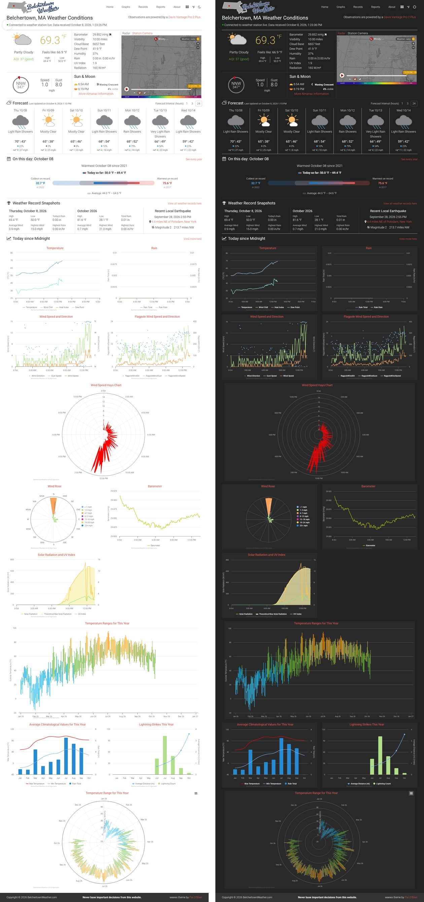

# Belchertown weewx skin

  

A skin (website theme) for the [weewx weather software](https://weewx.com), modeled after my website [BelchertownWeather.com](https://belchertownweather.com).

**📖 Documentation: [poblabs.github.io/weewx-belchertown](https://poblabs.github.io/weewx-belchertown/)**

* **Charts you design**, with a [chart builder](https://poblabs.github.io/weewx-belchertown/charts/chart-builder/) that draws them from your own data as you go, and a [gallery](https://poblabs.github.io/weewx-belchertown/charts/gallery/) of every chart type to copy from.
* **Highcharts or Apache ECharts**: ECharts is free for any website, including businesses, clubs and non-profits ([compare them](https://poblabs.github.io/weewx-belchertown/charts/#highcharts-or-echarts)).
* **Live updates** on the home page without reloading, with MQTT.
* **Forecasts, air quality and (in the US) weather alerts** with no setup, from Open-Meteo and the National Weather Service; Xweather optional.
* **Records**, "On this day" and your nearest recent earthquake.
* **Light and dark mode** and a **°F/°C button**, on phones, tablets and wall displays.

> [!IMPORTANT]
> **Belchertown 3 requires weewx 5.0 or newer.** On weewx 3 or 4, use [Belchertown 1.3.1](https://github.com/poblabs/weewx-belchertown/releases/tag/weewx-belchertown-1.3.1). Coming from 1.3.1? See [Upgrading from 1.x](https://poblabs.github.io/weewx-belchertown/upgrading/).

## Quick start

1. Download the latest `weewx-belchertown-x.x.x.tar.gz` from the [releases page](https://github.com/poblabs/weewx-belchertown/releases).
2. Install it: `weectl extension install weewx-belchertown-x.x.x.tar.gz`
3. In `weewx.conf`, check that `[Station]` has your `latitude` and `longitude`, and set `HTML_ROOT` in the `[[Belchertown]]` section to a folder your web server shows, for example `/var/www/html/weewx/belchertown`.
4. Restart weewx (`sudo systemctl restart weewx`) and wait for the next report, or run `weectl report run`.

The [install guide](https://poblabs.github.io/weewx-belchertown/install/) has the details, including where `weewx.conf` is and how to make Belchertown your main website. Then [make it yours](https://poblabs.github.io/weewx-belchertown/customize/).

## Help

* [Troubleshooting and FAQ](https://poblabs.github.io/weewx-belchertown/troubleshooting/)
* Questions: [GitHub Discussions](https://github.com/poblabs/weewx-belchertown/discussions)
* Found a bug? [Open an issue](https://github.com/poblabs/weewx-belchertown/issues/new/choose)

## Development version

To try the newest changes before they're released, download the [`next` branch](https://github.com/poblabs/weewx-belchertown/archive/next.zip) and install it with `weectl extension install next.zip`, then restart weewx. Expect rough edges.

The documentation lives in the `docs` folder of this repository and is published to the site above whenever `master` changes. Corrections are welcome as pull requests.

## Donate

This project took a lot of coffee to create. If you enjoy this skin and find some value from it, [click here to buy me another cup of coffee](https://paypal.me/pobhq) :)

## Credits

See [Credits and thanks](https://poblabs.github.io/weewx-belchertown/about/). Belchertown is free software under the GNU GPL v3.
