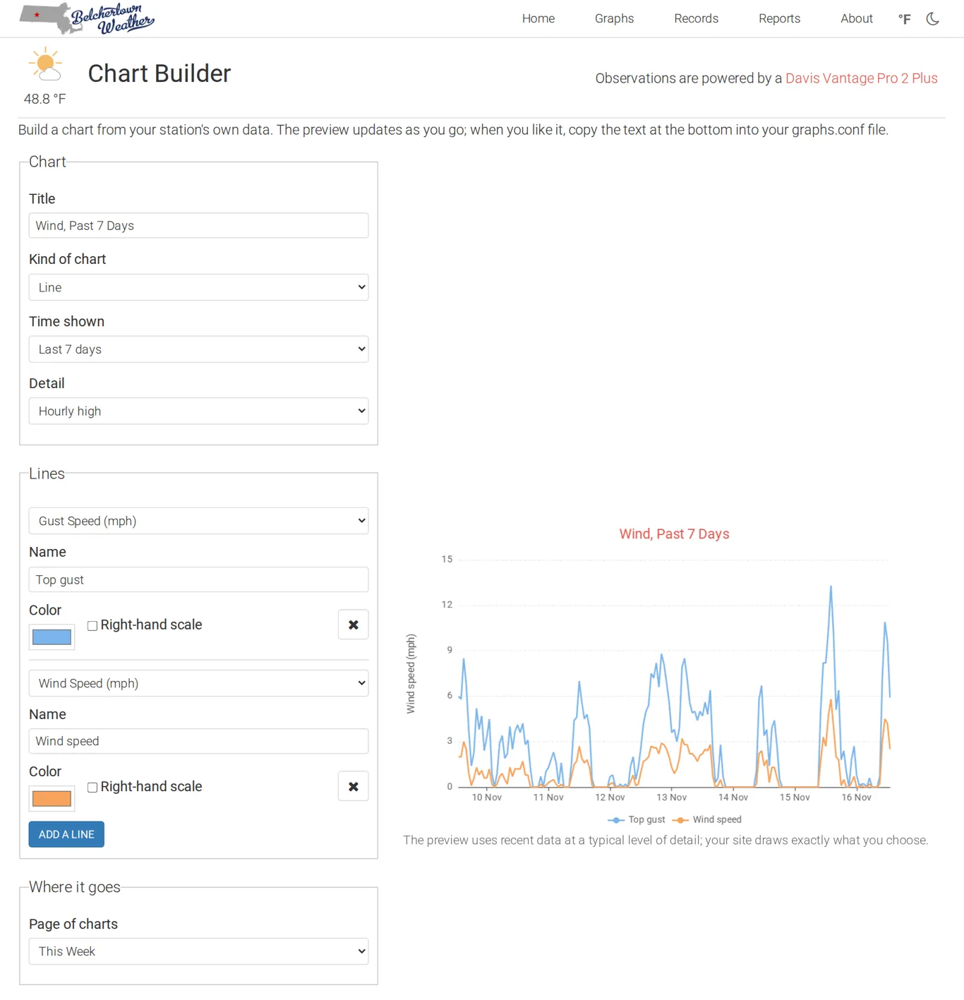
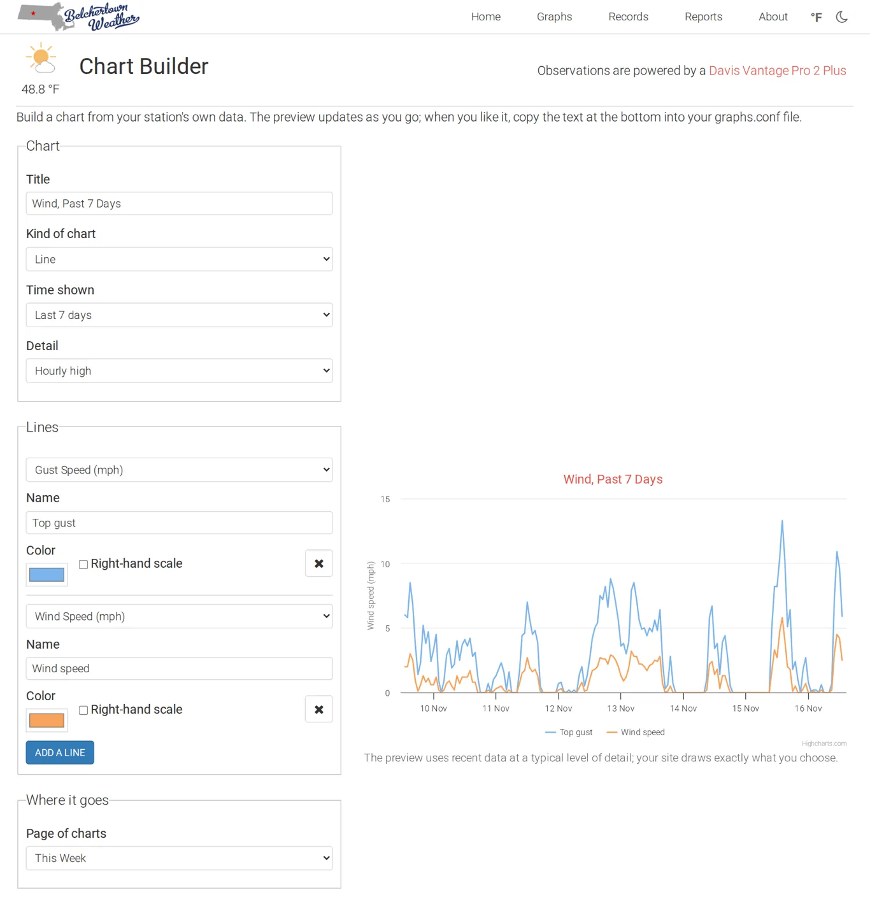
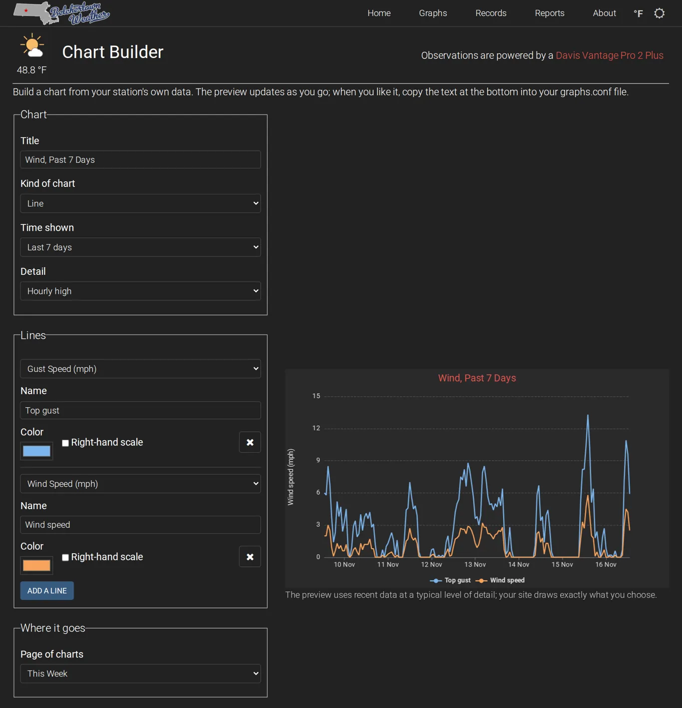
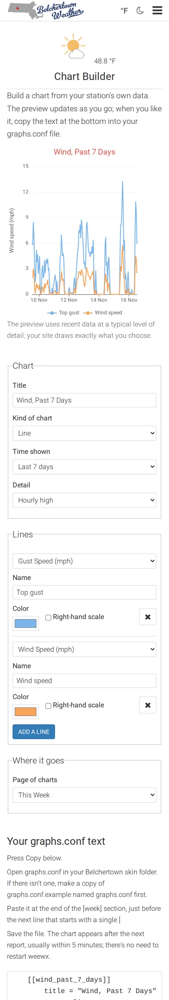
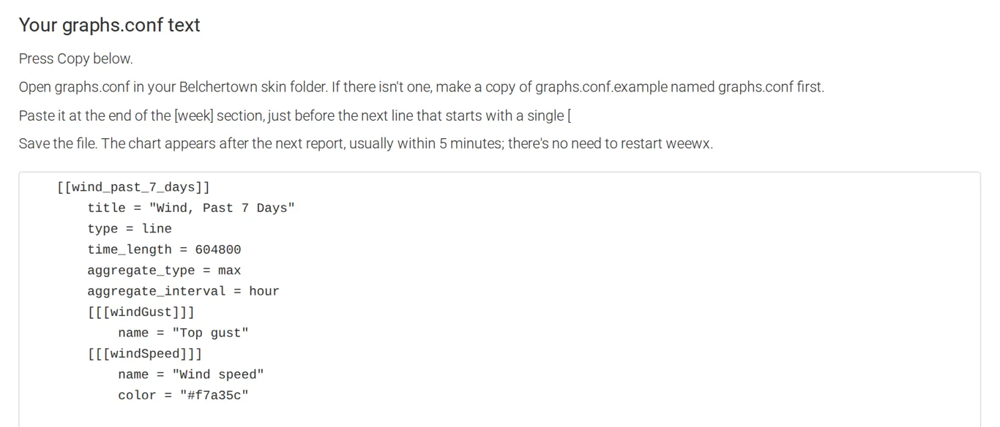

# Chart builder

**Make a chart by pointing and clicking.** The chart builder is a page on your own Belchertown site. Pick what to plot and how much time it covers, and the chart draws itself from your station's own data as you go. When it looks right, press Copy and paste the text into `graphs.conf`. You never have to write chart settings by hand.

[See it working on BelchertownWeather.com](https://belchertownweather.com/chart-builder/){ .md-button .md-button--primary }

It comes with Belchertown and is turned on from the start. It works with both chart libraries, in light and dark mode, and on phones.

=== "ECharts"

    

=== "Highcharts"

    

=== "Dark mode"

    

=== "Phone"

    { width="390" }

## Open it

Add `chart-builder/` to the end of your Belchertown site's address, for example:

```
http://raspberrypi.local/weewx/belchertown/chart-builder/
```

It isn't in your site's menu, so **bookmark it**. (To put it in the menu, see [below](#put-it-in-your-sites-menu).)

## Build a chart, step by step

This example makes the chart in the pictures above: the wind over the past week, with the top gust and the wind speed of each hour.

**1. Chart.** Give it a **Title** ("Wind, Past 7 Days"). Choose the **Kind of chart**: Line, Smooth line, Shaded area, Columns or Dots. Then how much **Time shown** (today, the last 24 hours, this week, the last 7 days, this month, the last 30 days, this year or the last 365 days) and the **Detail**:

| Detail | What it draws | Good for |
| --- | --- | --- |
| Every reading | Every record weewx saved | A day or two |
| Hourly average, high, low or total | One point per hour | A few days to a week |
| Daily average, high, low or total | One point per day | A month or a year |

Use **total** for rain, **high** for gusts, **low** for overnight temperatures, and **average** for most other things. The more time a chart covers, the less detail it needs: a year of every reading is slow to load and too crowded to read.

**2. Lines.** The first line is already there. Choose what it shows from the list, which has every reading your weewx database keeps (Gust Speed for this example). Give it a **Name** for the legend if you like ("Top gust"), and a **Color**. Press **Add a line** for another one on the same chart (Wind Speed). Tick **Right-hand scale** for a line measured in something different from the others, such as rain on a temperature chart, so each gets its own scale. The × button removes a line.

**3. Where it goes.** Choose the **Page of charts** it belongs on: every chart group in your `graphs.conf` is listed (Today, This Week and so on), or pick **A new page of charts**, which gets its own button on the Graphs page. Give a new page a title.

**4. Copy it.** Under **Your graphs.conf text**, the builder shows the text for your chart and says exactly where to paste it. Press **Copy**.



**5. Paste it into graphs.conf.** Open `graphs.conf` in the Belchertown skin folder ([where is it?](../before-you-start.md#which-kind-of-weewx-you-have)). If there isn't one yet, make it from the example first (package install shown):

```
cd /etc/weewx/skins/Belchertown
sudo cp graphs.conf.example graphs.conf
sudo nano graphs.conf
```

Paste where the builder said: at the end of the page's section, just before the next line that starts with a single `[`, or at the very end of the file for a new page. In nano, move with the arrow keys and paste with a right-click (Windows), Command + V (Mac) or Ctrl + Shift + V. Save with Ctrl + O, Enter, and leave with Ctrl + X.

**6. Wait for the next report.** The chart appears within about 5 minutes. There's no need to restart weewx.

For the example above, the builder writes:

```
    [[wind_past_7_days]]
        title = "Wind, Past 7 Days"
        type = line
        time_length = 604800
        aggregate_type = max
        aggregate_interval = hour
        [[[windGust]]]
            name = "Top gust"
        [[[windSpeed]]]
            name = "Wind speed"
            color = "#f7a35c"
```

## Going further

The builder covers the everyday charts. For more, edit the text it gave you, using the [graphs.conf reference](graphs-conf.md) and the [chart gallery](gallery.md): wind roses, Hays charts, temperature ranges, gauges, grouping by month, and settings such as `yAxis_min`. A good way to learn: build something close in the builder, paste it, then change one setting at a time.

## Questions

**Is it safe to have on my site?**
Yes. It only reads your data and can't change anything on your server, so it needs no password. Nothing you do there is saved; the text only goes where you paste it. Search engines are asked not to list it.

**The preview looks a little different from the chart on my site.**
The preview uses recent data at a typical level of detail, so it opens quickly. Your site draws exactly what you chose.

**A reading I expected isn't in the list.**
The list is every column in your weewx database. Something your station reports but weewx doesn't save has no history to chart; see [Adding a new observation](../new-observations.md).

**Is the data up to date?**
The builder reads `json/chart_builder.json`, which the first report writes and later reports refresh once an hour.

**How do I turn it off?**
Set `chart_builder_enabled = 0` in `[[[Extras]]]` ([how](../how-do-i.md)) and restart weewx.

## Put it in your site's menu

To give the builder a place in the menu at the top of every page, add a link to it in `menu.inc` ([how](custom-pages.md#add-links-to-the-menu)):

```html
<li class="menu-item"><a href="$relative_url/chart-builder/">Chart builder</a></li>
```
