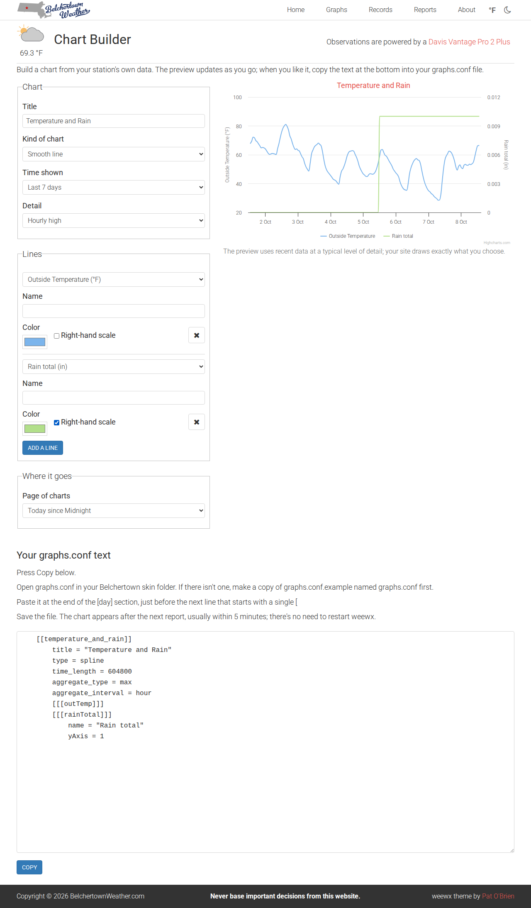

# Chart builder

The easiest way to add a chart is the chart builder: a page on your own site where you pick what to show and see the chart drawn from your station's data as you go. It gives you the text to paste into `graphs.conf`.

1. Open `chart-builder/` on your site, for example `https://www.example.com/chart-builder/` (or `https://www.example.com/weather/chart-builder/` if your weather pages live in a folder). It isn't in the menu, so bookmark it.
2. Give the chart a title, then choose the kind of chart, how much time it covers and how much detail. Under Lines, choose what to plot; Add a line puts more on the same chart. Tick Right-hand scale for a line measured in something different, such as rain on a temperature chart.
3. Under Where it goes, pick the page of charts it belongs on, or A new page of charts.
4. Press Copy and follow the steps under the text: paste it into `graphs.conf` (in your Belchertown skin folder), save, and the chart shows up after the next report. There's no need to restart weewx.

The page only reads your data and can't change anything on your server, so it needs no password. Search engines are asked not to list it. The data behind it (`json/chart_builder.json`) is written by the first report and refreshed once an hour. To turn it off, set `chart_builder_enabled = 0`.
