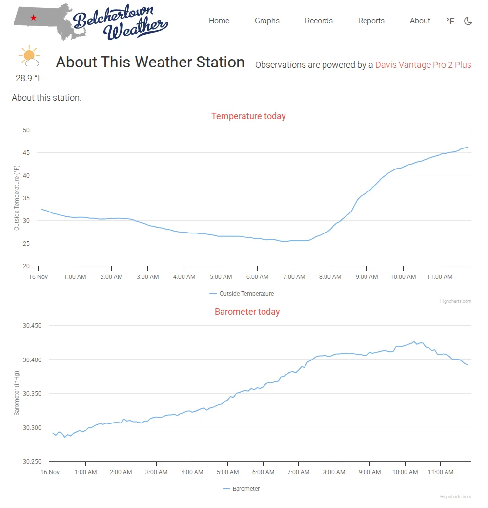
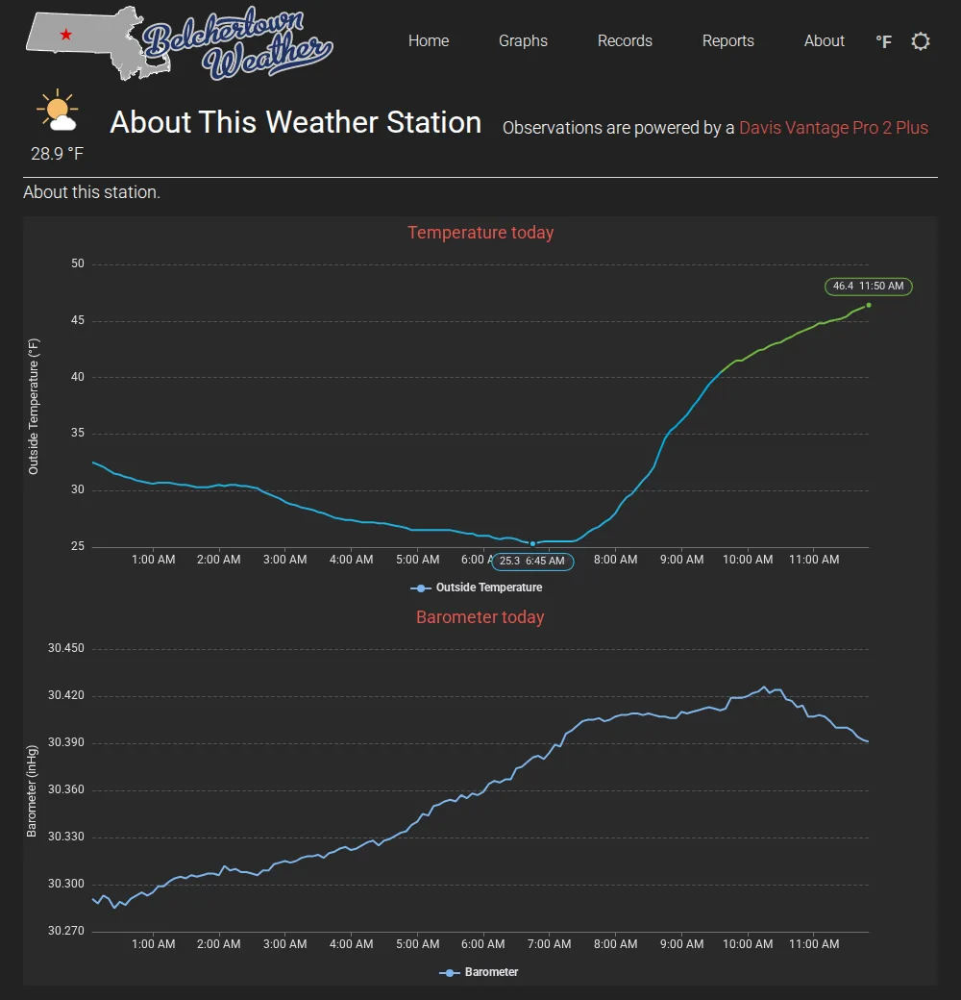
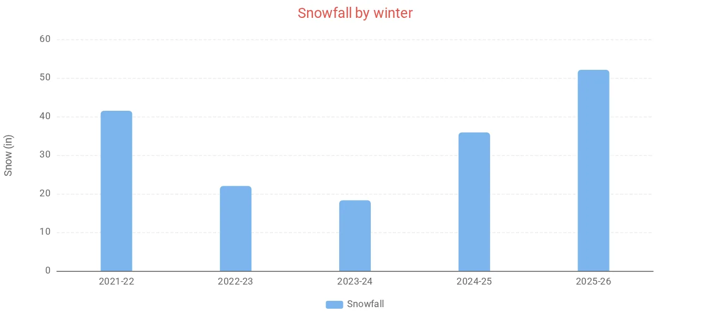

# Charts on your own pages

Charts don't have to live on the home page and the Graphs page. There are three ways to put them somewhere else, and **all three work with both [Highcharts and ECharts](index.md#highcharts-or-echarts)**, because the skin draws them with whichever library `chart_library` picks. Switch libraries and your pages follow, with no changes.

| You want | Use | Data from |
| --- | --- | --- |
| A new page of charts with its own button on the Graphs page | [A chart group with a button](#a-page-of-charts-on-the-graphs-page) | Your weewx database |
| Charts on the About page, the Records page or a block on the home page | [showChart](#charts-on-the-about-page-or-a-home-page-block) | Your weewx database |
| A chart of numbers you have yourself, such as snowfall you measure by hand | [draw_chart](#a-chart-you-write-yourself) | Numbers you type in, or your own JSON file |

!!! warning "Don't call Highcharts.chart() yourself"
    An older custom page may draw its chart with `Highcharts.chart(...)` or `new Highcharts.Chart(...)`. That only works while `chart_library = highcharts`: with ECharts, Highcharts isn't loaded and the chart stays empty. Change `Highcharts.chart(options)` to `draw_chart(options)`, as in [the third example](#a-chart-you-write-yourself), and it works with both.

## A page of charts on the Graphs page

Every chart group in `graphs.conf` with `show_button = true` gets a button on the Graphs page, and its own address: `graphs/?graph=` and the group's name. This group adds a **Wind** page with a short introduction above the charts:

```
[windpage]
    title = Wind
    show_button = true
    button_text = Wind
    page_content = "Wind at the station, from the anemometer on the roof at 30 feet."
    time_length = week

    [[windrose]]
        title = Wind Rose, Past Week
        [[[windRose]]]

    [[windspeed]]
        title = Wind Speed, Past Week
        aggregate_type = max
        aggregate_interval = hour
        [[[windGust]]]
        [[[windSpeed]]]
            type = area
```

After the next report, the button appears and `https://www.example.com/graphs/?graph=windpage` opens the page directly. `page_content` can hold HTML, such as a link or a picture. The [chart gallery](gallery.md) has charts to fill it with, and [graphs.conf reference](graphs-conf.md#reference-chart-group-settings) has every group setting. To make the page show up first on the Graphs page, set `graph_page_default_graphgroup = windpage` in `[[[Extras]]]`.

## Charts on the About page or a home page block

You can show charts on any page that takes your own `.inc` file: the About page (`about.inc`), the Records page (`records.inc`), a [home page block](../customize.md#choose-whats-on-the-home-page-and-in-what-order) (`home_<name>.inc`) or one of the [home page hooks](../customize.md#add-your-own-content-to-the-home-page). This example adds two charts to the About page.

1. In `graphs.conf`, add a chart group for the page. Leave out `show_button`, so it doesn't get a button on the Graphs page:

    ```
    [about]
        time_length = today
        gapsize = 300

        [[abouttemp]]
            title = Temperature today
            [[[outTemp]]]

        [[aboutbaro]]
            title = Barometer today
            [[[barometer]]]
    ```

2. In the Belchertown skin folder, open `about.inc` in a text editor (if you don't have one yet, copy `about.inc.example` to `about.inc`).
3. Where each chart should appear, add an empty box whose `id` is the chart's name from the double brackets. Then, after the boxes, add one line that loads the group:

    ```html
    <div id="abouttemp" style="height: 400px;"></div>
    <div id="aboutbaro" style="height: 400px;"></div>
    <script>showChart("about");</script>
    ```

4. Run `weectl report run` or wait for the next report, and open the About page.

=== "Highcharts"

    

=== "ECharts"

    

`showChart` takes the chart group name. Each chart's `id` must be unique on the page, so don't reuse names from the home page group (such as `chart1`) on a home page block. The charts follow the light and dark theme and the °F/°C button like the skin's own.

## A chart you write yourself

For numbers that aren't in your weewx database, build the chart in a few lines of JavaScript with two of the skin's own functions:

* `chart_base_options()` gives you the skin's chart settings: its fonts, colors, dark mode and tooltips.
* `draw_chart(options)` draws the chart with Highcharts or ECharts, whichever `chart_library` picks.

The settings are written the Highcharts way ([the Highcharts API](https://api.highcharts.com/highcharts/) describes them all). With ECharts, the skin translates the common ones: the chart `type` (`line`, `spline`, `area`, `column`, `scatter`), `title`, `xAxis` with `categories` or times, one or two `yAxis` with a `title`, `min` and `max`, and each series' `name`, `data`, `color`, `yAxis`, `dashStyle`, `step` and `stacking`. A setting it doesn't know is skipped, and the rest of the chart still draws.

This example, in `about.inc`, charts the snowfall of the last five winters:

```html
<div id="snowchart" style="height: 400px;"></div>
<script>
var options = chart_base_options(false, true);
options.chart.renderTo = "snowchart";
options.chart.type = "column";
options.title.text = "Snowfall by winter";
options.xAxis = {categories: ["2021-22", "2022-23", "2023-24", "2024-25", "2025-26"]};
options.yAxis = [{title: {text: "Snow (in)"}}];
options.series = [{name: "Snowfall", data: [41.5, 22.0, 18.3, 35.9, 52.1]}];
draw_chart(options);
</script>
```

=== "Highcharts"

    

=== "ECharts"

    

Always set `options.chart.type`: Highcharts draws nothing without it. `chart_base_options(exporting, legend)` takes two settings: `true` as the first adds the download button, `true` as the second shows the legend. For points in time instead of categories, leave out `xAxis` and give each point as `[time, value]`, with the time in milliseconds since 1970 (a weewx time times 1000): `data: [[1767225600000, 12.5], [1767312000000, 14.1]]`.

To read your numbers from a file instead of typing them in, put a JSON file in your website folder and fetch it first:

```html
<div id="snowchart" style="height: 400px;"></div>
<script>
fetch("snow.json").then(function(r) { return r.json(); }).then(function(snow) {
    var options = chart_base_options(false, true);
    options.chart.renderTo = "snowchart";
    options.chart.type = "column";
    options.title.text = "Snowfall by winter";
    options.xAxis = {categories: snow.winters};
    options.series = [{name: "Snowfall", data: snow.inches}];
    draw_chart(options);
});
</script>
```

with `snow.json` holding `{"winters": ["2024-25", "2025-26"], "inches": [35.9, 52.1]}`.

!!! tip "Seeing what the skin builds"
    With [debug mode](../troubleshooting.md#debug-mode) on, the browser console shows the full settings of every chart the skin draws, which is a good starting point for your own.
