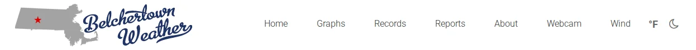
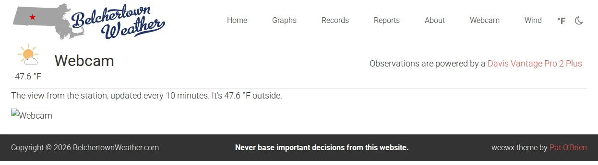
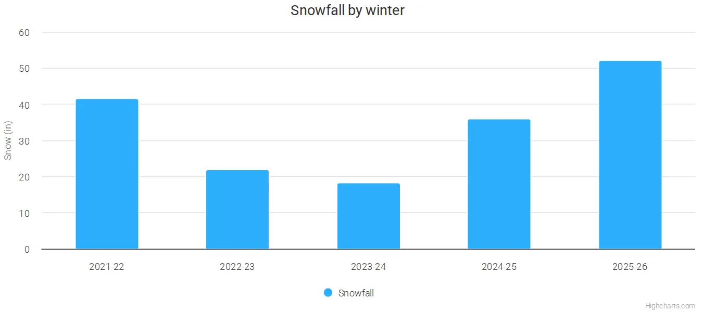

# Your own pages and charts

You can add your own pages to the site, put links to them in the menu, and show charts anywhere: on your own pages, the About page, or a home page block. **Every chart here works with both [Highcharts and ECharts](index.md#highcharts-or-echarts)**, because the skin draws it with whichever library `chart_library` picks. Switch libraries and your pages follow, with no changes.

Everything on this page is kept when you [upgrade](../upgrade.md): it lives in your own files and in `weewx.conf`, never in the skin's.

| You want | Use |
| --- | --- |
| A link in the menu at the top of every page | [menu.inc](#add-links-to-the-menu) |
| A whole page of your own, such as a webcam page | [Your own page](#a-page-of-your-own) |
| A new page of charts, with its own button on the Graphs page | [A chart group with a button](#a-page-of-charts-on-the-graphs-page) |
| Charts on the About page, the Records page, your own page or a home page block | [showChart](#charts-on-the-about-page-or-a-home-page-block) |
| A chart of numbers you have yourself, such as snowfall you measure by hand | [draw_chart](#a-chart-you-write-yourself) |

## Add links to the menu

The menu at the top of every page (Home, Graphs, Records, Reports, About) can have your own links after About. Create a file called `menu.inc` in the Belchertown skin folder ([where is it?](../before-you-start.md#which-kind-of-weewx-you-have)) with one line per link:

```html
<li class="menu-item"><a href="$relative_url/webcam/">Webcam</a></li>
<li class="menu-item"><a href="$relative_url/graphs/?graph=windpage">Wind</a></li>
<li class="menu-item"><a href="https://www.wunderground.com/dashboard/pws/YOURID" target="_blank">Weather Underground</a></li>
```

* Change the words between `>` and `</a>` to what the menu should say.
* For a page on your own site, start the address with `$relative_url/`. The skin fills it in so the link works from every page, the home page and the pages in folders alike.
* For another website, use its full address. `target="_blank"` opens it in a new tab.

The links appear at the next report, on computers and in the phone menu. There's no need to restart weewx. Two or three extra links fit on most screens; more may wrap onto a second line on a small laptop.



## A page of your own

A page of your own looks like the rest of the site: the same header, menu, footer, light and dark theme. It takes three things: the page itself, one setting so weewx builds it, and a menu link. This example makes a **Webcam** page at `webcam/` on your site.

**1. Make the page.** In the Belchertown skin folder, make a folder called `webcam` and, in it, a file called `index.html.tmpl` (package install shown):

```
cd /etc/weewx/skins/Belchertown
sudo mkdir webcam
sudo nano webcam/index.html.tmpl
```

Paste this in, and change the text and the picture's address to yours:

```html
#errorCatcher Echo
#encoding UTF-8
#set global $page = "webcam"
#set global $page_header = "Webcam"

    #include "header.html.tmpl"

    <div class="site-inner">
        <main class="content">
            <article class="weewx about">

                    #include "page-header.inc"

                    <p>The view from the station, updated every 10 minutes. It's $current.outTemp outside.</p>
                    

            </article>
        </main>
    </div>

    #include "footer.html.tmpl"
```

Keep the lines that start with `#` as they are, except the two with `webcam` and `Webcam`: `$page` is a short name for the page (letters only), and `$page_header` is the heading shown at the top. Everything between `page-header.inc` and `</article>` is your page: text, pictures, [weewx tags](../customize.md#about-and-records-pages) such as `$current.outTemp`, and [charts](#charts-on-the-about-page-or-a-home-page-block).

**2. Tell weewx to build it.** Open `weewx.conf` and add these lines inside the `[[Belchertown]]` section, after the `[[[Extras]]]` part:

```
    [[Belchertown]]
        ...
        [[[CheetahGenerator]]]
            [[[[ToDate]]]]
                [[[[[webcam]]]]]
                    template = webcam/index.html.tmpl
```

Count the brackets: three, four, five. (For a second page, add another `[[[[[name]]]]]` block under the same `[[[[ToDate]]]]`.) This adds your page to the skin's list of pages without changing `skin.conf`, so upgrades keep it. Then restart weewx.

**3. Add it to the menu** with `menu.inc`, as [above](#add-links-to-the-menu):

```html
<li class="menu-item"><a href="$relative_url/webcam/">Webcam</a></li>
```

After the next report, the page is at your site's address plus `webcam/`, for example `http://raspberrypi.local/weewx/belchertown/webcam/`.



??? note "Something went wrong?"
    * **The page isn't there:** check the brackets in `weewx.conf` and that you restarted weewx. The weewx log says `Generated N files for report Belchertown`; that number goes up by one with your page.
    * **weewx won't start, or the log mentions `webcam/index.html.tmpl`:** a typo in the page. Copy the example again. A line of your own text that starts with `#` confuses weewx: don't start lines with `#` or `$` unless they're weewx tags.
    * **The page has no styling:** the page must be in a folder one level down (`webcam/index.html.tmpl`), as in the example, for the skin's styles to be found.

!!! warning "Don't call Highcharts.chart() yourself"
    An older custom page may draw its chart with `Highcharts.chart(...)` or `new Highcharts.Chart(...)`. That only works while `chart_library = highcharts`: with ECharts, Highcharts isn't loaded and the chart stays empty. Change `Highcharts.chart(options)` to `draw_chart(options)`, as in [the third example](#a-chart-you-write-yourself), and it works with both.

## A page of charts on the Graphs page

Every chart group in `graphs.conf` with `show_button = true` gets a button on the Graphs page, and its own address: `graphs/?graph=` and the group's name. This group adds a **Wind** page with a short introduction above the charts:

```
[windpage]
    title = Wind
    show_button = true
    button_text = Wind
    page_content = "Wind at the station, from the anemometer on the roof at 30 feet."
    time_length = week

    [[windrose]]
        title = Wind Rose, Past Week
        [[[windRose]]]

    [[windspeed]]
        title = Wind Speed, Past Week
        aggregate_type = max
        aggregate_interval = hour
        [[[windGust]]]
        [[[windSpeed]]]
            type = area
```

After the next report, the button appears and `https://www.example.com/graphs/?graph=windpage` opens the page directly. `page_content` can hold HTML, such as a link or a picture. The [chart gallery](gallery.md) has charts to fill it with, and [graphs.conf reference](graphs-conf.md#reference-chart-group-settings) has every group setting. To make the page show up first on the Graphs page, set `graph_page_default_graphgroup = windpage` in `[[[Extras]]]`.

## Charts on the About page or a home page block

You can show charts on [a page of your own](#a-page-of-your-own) and on any page that takes your own `.inc` file: the About page (`about.inc`), the Records page (`records.inc`), a [home page block](../customize.md#choose-whats-on-the-home-page-and-in-what-order) (`home_<name>.inc`) or one of the [home page hooks](../customize.md#add-your-own-content-to-the-home-page). This example adds two charts to the About page.

1. In `graphs.conf`, add a chart group for the page. Leave out `show_button`, so it doesn't get a button on the Graphs page:

    ```
    [about]
        time_length = today
        gapsize = 300

        [[abouttemp]]
            title = Temperature today
            [[[outTemp]]]

        [[aboutbaro]]
            title = Barometer today
            [[[barometer]]]
    ```

2. In the Belchertown skin folder, open `about.inc` in a text editor (if you don't have one yet, copy `about.inc.example` to `about.inc`).
3. Where each chart should appear, add an empty box whose `id` is the chart's name from the double brackets. Then, after the boxes, add one line that loads the group:

    ```html
    <div id="abouttemp" style="height: 400px;"></div>
    <div id="aboutbaro" style="height: 400px;"></div>
    <script>showChart("about");</script>
    ```

4. Run `weectl report run` or wait for the next report, and open the About page.

=== "Highcharts"

    

=== "ECharts"

    

`showChart` takes the chart group name. Each chart's `id` must be unique on the page, so don't reuse names from the home page group (such as `chart1`) on a home page block. The charts follow the light and dark theme and the °F/°C button like the skin's own.

## A chart you write yourself

For numbers that aren't in your weewx database, build the chart in a few lines of JavaScript with two of the skin's own functions:

* `chart_base_options()` gives you the skin's chart settings: its fonts, colors, dark mode and tooltips.
* `draw_chart(options)` draws the chart with Highcharts or ECharts, whichever `chart_library` picks.

The settings are written the Highcharts way ([the Highcharts API](https://api.highcharts.com/highcharts/) describes them all). With ECharts, the skin translates the common ones: the chart `type` (`line`, `spline`, `area`, `column`, `scatter`), `title`, `xAxis` with `categories` or times, one or two `yAxis` with a `title`, `min` and `max`, and each series' `name`, `data`, `color`, `yAxis`, `dashStyle`, `step` and `stacking`. A setting it doesn't know is skipped, and the rest of the chart still draws.

This example, in `about.inc`, charts the snowfall of the last five winters:

```html
<div id="snowchart" style="height: 400px;"></div>
<script>
var options = chart_base_options(false, true);
options.chart.renderTo = "snowchart";
options.chart.type = "column";
options.title.text = "Snowfall by winter";
options.xAxis = {categories: ["2021-22", "2022-23", "2023-24", "2024-25", "2025-26"]};
options.yAxis = [{title: {text: "Snow (in)"}}];
options.series = [{name: "Snowfall", data: [41.5, 22.0, 18.3, 35.9, 52.1]}];
draw_chart(options);
</script>
```

=== "Highcharts"

    

=== "ECharts"

    

Always set `options.chart.type`: Highcharts draws nothing without it. `chart_base_options(exporting, legend)` takes two settings: `true` as the first adds the download button, `true` as the second shows the legend. For points in time instead of categories, leave out `xAxis` and give each point as `[time, value]`, with the time in milliseconds since 1970 (a weewx time times 1000): `data: [[1767225600000, 12.5], [1767312000000, 14.1]]`.

To read your numbers from a file instead of typing them in, put a JSON file in your website folder and fetch it first:

```html
<div id="snowchart" style="height: 400px;"></div>
<script>
fetch("snow.json").then(function(r) { return r.json(); }).then(function(snow) {
    var options = chart_base_options(false, true);
    options.chart.renderTo = "snowchart";
    options.chart.type = "column";
    options.title.text = "Snowfall by winter";
    options.xAxis = {categories: snow.winters};
    options.series = [{name: "Snowfall", data: snow.inches}];
    draw_chart(options);
});
</script>
```

with `snow.json` holding `{"winters": ["2024-25", "2025-26"], "inches": [35.9, 52.1]}`.

!!! tip "Seeing what the skin builds"
    With [debug mode](../troubleshooting.md#debug-mode) on, the browser console shows the full settings of every chart the skin draws, which is a good starting point for your own.
