# Chart gallery

Every kind of chart the skin can draw, with the `graphs.conf` text that made it. All of them were drawn from the same weather station's data, by the skin itself, with both chart libraries. Use the **Highcharts** and **ECharts** tabs to compare: picking one switches every chart on the page. See [Highcharts or ECharts](index.md#highcharts-or-echarts) for which to use.

Each example is one chart. Paste it inside a chart group in `graphs.conf` (for example under `[day]`), with the indentation shown, and it appears after the next report. The [graphs.conf reference](graphs-conf.md) explains every setting. The [chart builder](chart-builder.md) on your own site writes most of these for you.

!!! tip "Your data, not ours"
    These charts show one station in Massachusetts. Yours draw from your own database, so a chart of a sensor you don't have stays empty. The names in triple brackets (`[[[outTemp]]]`) must be columns in your weewx database.

## Lines

The simplest chart: one or more observations as lines. The first observation picks the color from the [default palette](graphs-conf.md#default-color-palette) unless you give it a `color`.

=== "Highcharts"

    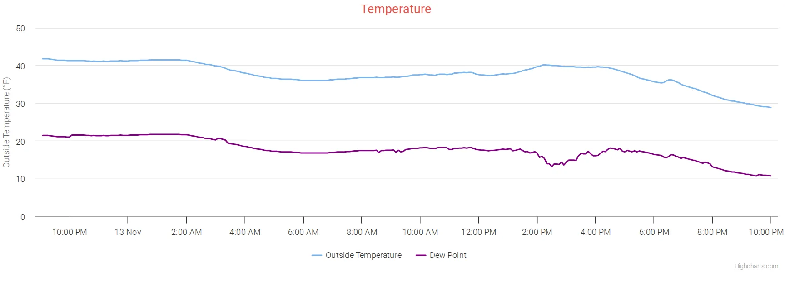

=== "ECharts"

    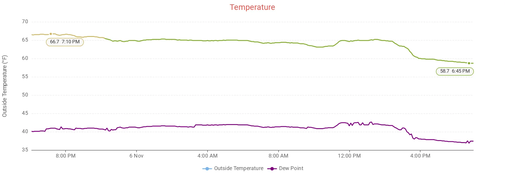

```
    [[templine]]
        title = Temperature
        [[[outTemp]]]
        [[[dewpoint]]]
            color = purple
```

With ECharts, the outside temperature line takes the skin's temperature colors (blue when cold, red when hot), and the day's high and low are marked with a label. Add `temperature_colors = false` under `[[[outTemp]]]` to keep a single color.

## Daylight shading { #daylight-shading }

The same lines with the daylight hours shaded behind them. The shading follows the sun: it rises at first light, covers the chart through the day, and fades after sunset.

=== "Highcharts"

    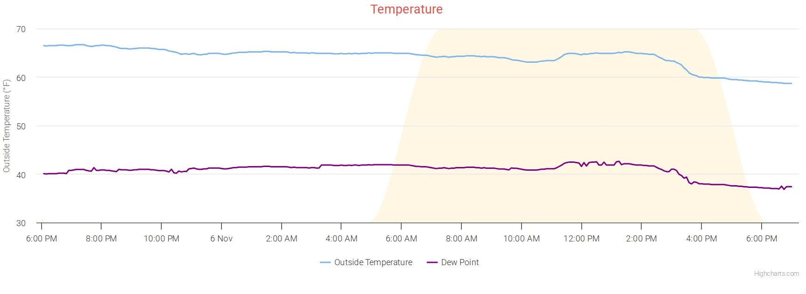

=== "ECharts"

    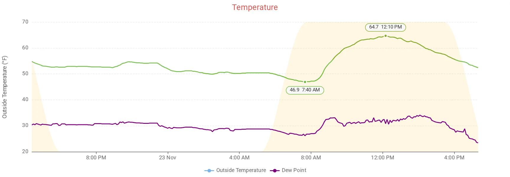

```
    [[daylight]]
        title = Temperature
        daylight_shading = true
        [[[outTemp]]]
        [[[dewpoint]]]
            color = purple
```

Put `daylight_shading = true` under a group such as `[day]` to shade all its charts. Week charts shade the nights as bands. See [daylight_shading](graphs-conf.md#daylight_shading).

## Wind speed and direction { #wind-speed-and-direction }

Three observations on one chart: wind speed as a shaded area, gusts as a line over it, and the direction as dots on the right-hand scale.

=== "Highcharts"

    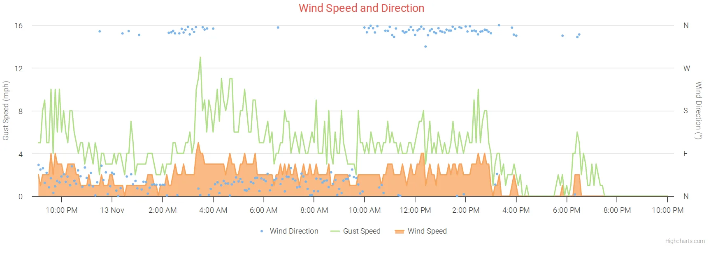

=== "ECharts"

    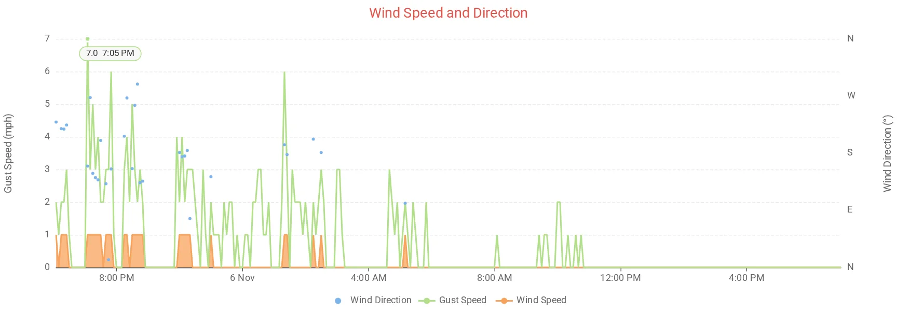

```
    [[windplt]]
        title = Wind Speed and Direction
        yAxis_min = 0
        [[[windDir]]]
            zIndex = 2
            yAxis = 1
            yAxis_max = 360
            lineWidth = 0
            [[[[marker]]]]
                enabled = true
            [[[[states]]]]
                [[[[[hover]]]]]
                    lineWidthPlus = 0
        [[[windGust]]]
            zIndex = 1
        [[[windSpeed]]]
            type = area
```

- `zIndex` decides what is drawn on top: speed at the bottom, gusts over it, direction on top.
- `yAxis = 1` puts the direction on the right-hand scale, which runs to 360 degrees and is labeled N, E, S, W.
- `lineWidth = 0` with `[[[[marker]]]]` `enabled = true` draws the direction as dots instead of a line. The `states` part stops a line from appearing when you point at it.

This "line drawn as dots" trick is used instead of a `scatter` chart because tooltips don't work well with a line and a scatter on the same chart.

## Rain

The rain rate, and the rain adding up through the day with the special `rainTotal` observation.

=== "Highcharts"

    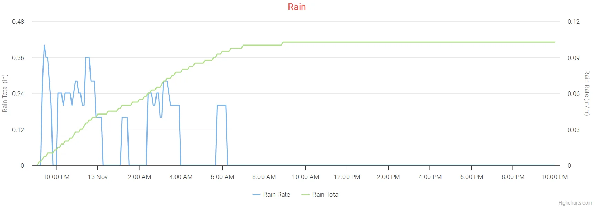

=== "ECharts"

    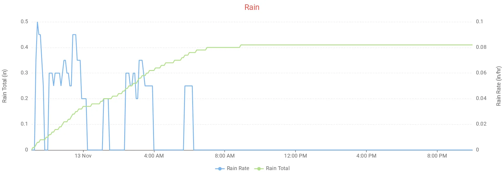

```
    [[rainchart]]
        title = Rain
        [[[rainRate]]]
            yAxis = 1
        [[[rainTotal]]]
            name = Rain Total
```

The weewx `rain` column holds only the rain counted in each archive record, so a chart of `rain` shows small spikes. `rainTotal` adds them up from the start of the chart. See [rainTotal](graphs-conf.md#raintotal).

## Smooth lines (spline)

`type = spline` draws a smoothed line. It can be set for the whole chart, as here, or for one observation.

=== "Highcharts"

    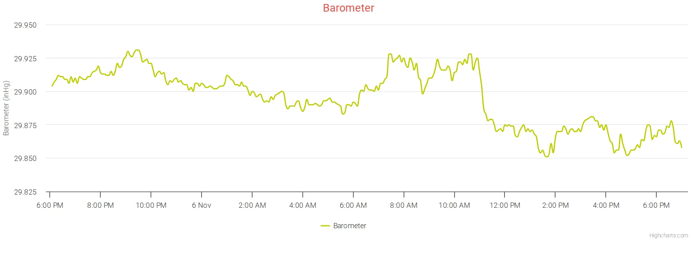

=== "ECharts"

    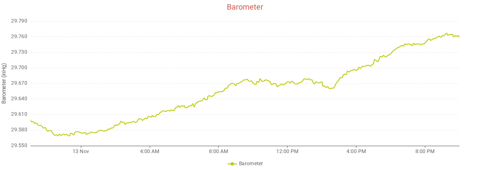

```
    [[barochart]]
        title = Barometer
        type = spline
        [[[barometer]]]
            color = "#BECC00"
```

## Line over a shaded area, with a second scale { #solar-radiation-and-uv }

Solar radiation as a line over the theoretical maximum as a shaded area, with the UV index on the right-hand scale from 0 to 14. Thanks to Belchertown user 41south for this combination.

=== "Highcharts"

    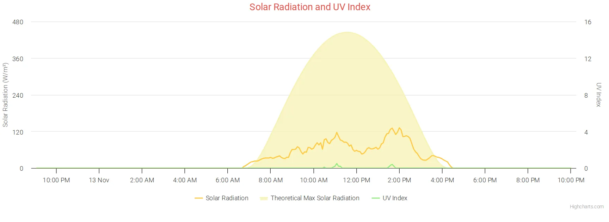

=== "ECharts"

    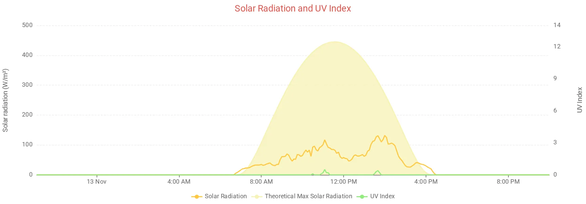

```
    [[solarRadGraph]]
        title = Solar Radiation and UV Index
        [[[radiation]]]
            name = Solar Radiation
            zIndex = 1
            color = "#ffc83f"
        [[[maxSolarRad]]]
            name = Theoretical Max Solar Radiation
            type = area
            color = "#f7f2b4"
            yAxis_label = "Solar radiation"
        [[[UV]]]
            yAxis = 1
            yAxis_min = 0
            yAxis_max = 14
            color = "#90ed7d"
            yAxis_label = "UV Index"
            name = UV Index
            zIndex = 2
```

`maxSolarRad` is calculated by weewx and is in weewx's standard database layout (`wview_extended`). If your database is older and doesn't have the column, see [Adding a new observation](../new-observations.md).

## Dashed and stepped lines

Highcharts series options written straight into `graphs.conf`: `dashStyle` for a dashed line and `step = true` for a line that moves in steps, which suits readings that change in whole numbers, like humidity.

=== "Highcharts"

    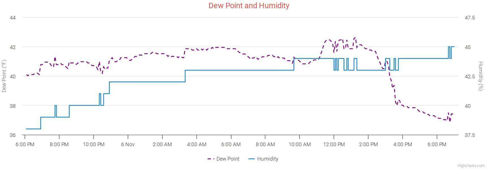

=== "ECharts"

    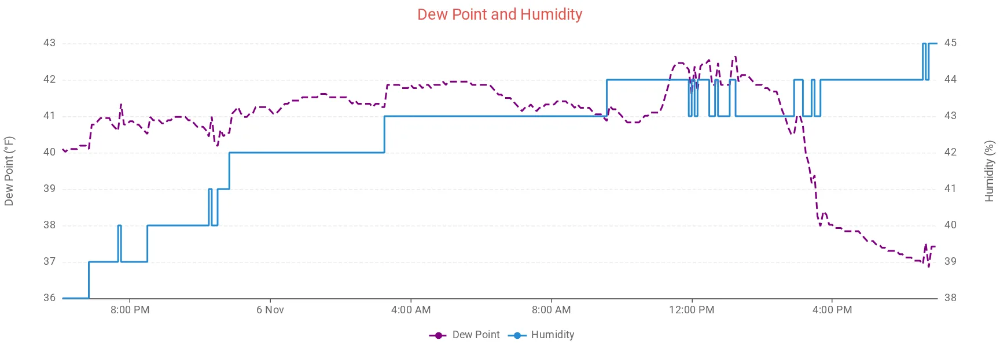

```
    [[dashedline]]
        title = Dew Point and Humidity
        [[[dewpoint]]]
            dashStyle = Dash
            color = purple
        [[[outHumidity]]]
            yAxis = 1
            step = true
            color = "#268bd2"
```

Any [Highcharts series option](https://api.highcharts.com/highcharts/series) can go under an observation. With ECharts the common ones carry over: `color`, `zIndex`, `lineWidth`, `marker`, `visible`, `dashStyle`, `step`, `zones` and `stacking`.

## Columns

Rain per day for the past 30 days: `aggregate_type = sum` with `aggregate_interval = day` adds up each day, and `type = column` draws a column for it. `time_length = 2592000` is 30 days in seconds.

=== "Highcharts"

    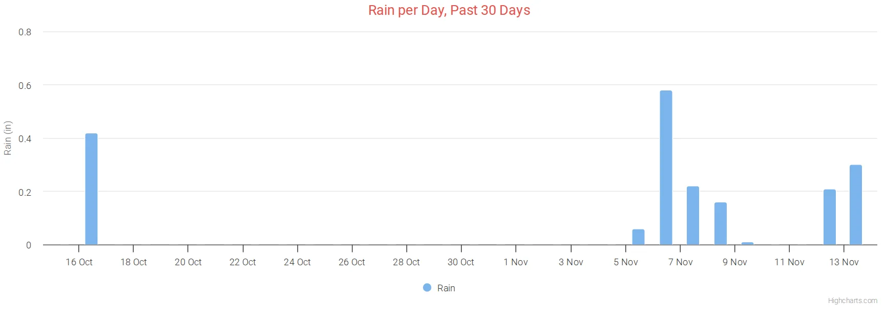

=== "ECharts"

    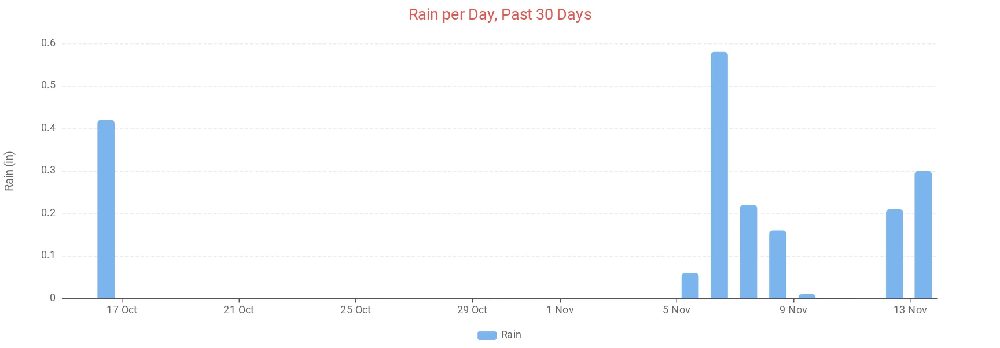

```
    [[dailyrain]]
        title = Rain per Day, Past 30 Days
        type = column
        time_length = 2592000
        aggregate_type = sum
        aggregate_interval = day
        gapsize = 86400
        tooltip_date_format = "LL"
        [[[rain]]]
            name = Rain
```

## Stacked columns

`stacking = normal` (a Highcharts option) puts the columns of each day on top of each other.

=== "Highcharts"

    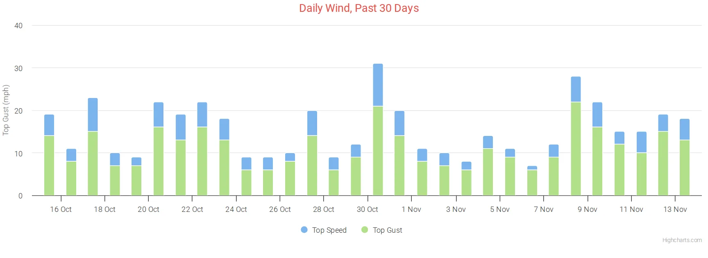

=== "ECharts"

    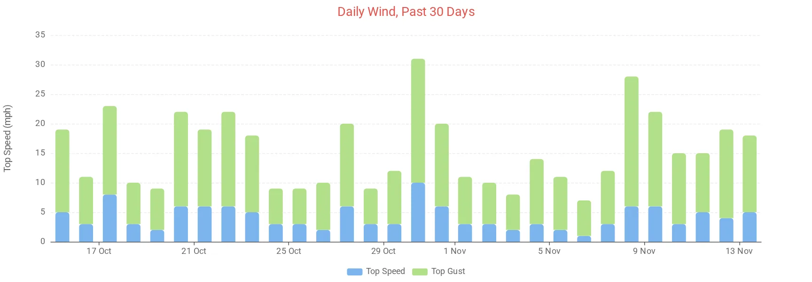

```
    [[stackedwind]]
        title = Daily Wind, Past 30 Days
        type = column
        time_length = 2592000
        aggregate_type = max
        aggregate_interval = day
        gapsize = 86400
        tooltip_date_format = "LL"
        [[[windSpeed]]]
            name = Top Speed
            stacking = normal
        [[[windGust]]]
            name = Top Gust
            stacking = normal
```

Highcharts stacks the first observation on top, ECharts at the bottom.

## Mirrored columns { #mirrored-stacked-column-chart }

Columns above and below the zero line. `mirrored_value = true` turns an observation's values negative, so it is drawn below the line, while its labels and tooltip still read as positive numbers. It suits pairs like energy used and energy sent back to the grid.

=== "Highcharts"

    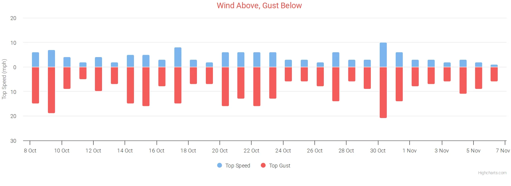

=== "ECharts"

    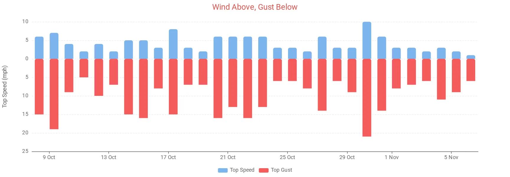

```
    [[mirrored]]
        title = Wind Above, Gust Below
        type = column
        time_length = 2592000
        aggregate_type = max
        aggregate_interval = day
        gapsize = 86400
        tooltip_date_format = "LL"
        [[[windSpeed]]]
            name = Top Speed
            stacking = normal
        [[[windGust]]]
            name = Top Gust
            stacking = normal
            mirrored_value = true
            color = "#f45b5b"
```

## Monthly climate chart { #monthly-climate-chart }

The last 12 months, one point per month: rain as columns on the right-hand scale, and the highest and lowest temperature of each month as lines with dots.

=== "Highcharts"

    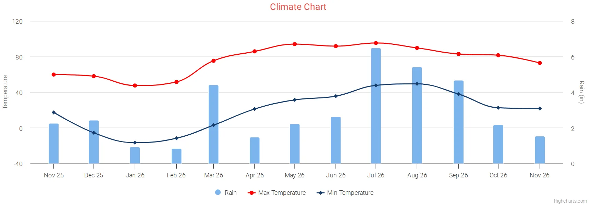

=== "ECharts"

    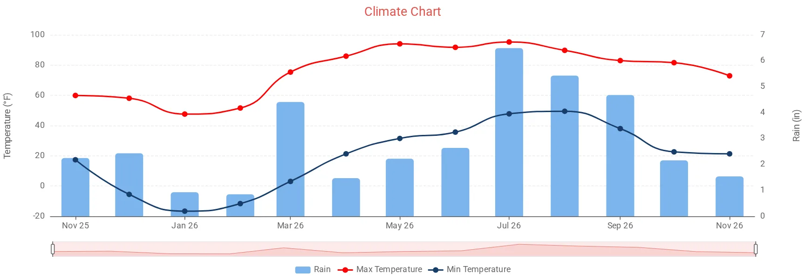

```
    [[climate]]
        title = Climate Chart
        aggregate_interval = month
        time_length = month_ago_to_now
        time_ago = 12
        start_at_midnight = true
        start_at_beginning_of_month = true
        gapsize = 2678400
        tooltip_date_format = "MMM YYYY"
        [[[rain]]]
            type = column
            aggregate_type = sum
            name = Rain
            pointWidth = 20
            yAxis = 1
        [[[outTemp]]]
            type = spline
            aggregate_type = max
            zIndex = 1
            name = Max Temperature
            color = "#fc0404"
            yAxis_label = "Temperature"
            [[[[marker]]]]
                enabled = true
                radius = 4
        [[[outTemp_min]]]
            type = spline
            name = Min Temperature
            observation_type = outTemp
            aggregate_type = min
            zIndex = 2
            color = "#173c6a"
            yAxis_label = "Temperature"
            [[[[marker]]]]
                enabled = true
                radius = 4
```

`gapsize = 2678400` is 31 days, so a month with no data shows as a gap. `radius = 4` inside `[[[[marker]]]]` is the size of the dots in pixels. `[[[outTemp_min]]]` shows how to chart the same observation twice: give it any name you like and set `observation_type`.

With ECharts, a chart that covers months gets a strip underneath for sliding through it.

## Grouped by month

`xAxis_groupby = month` puts all of the year's readings for January together, February together, and so on, with `xAxis_categories` as the labels. See [Grouping by month or year](graphs-conf.md#grouping-by-month-or-year), which also covers averages over many years.

=== "Highcharts"

    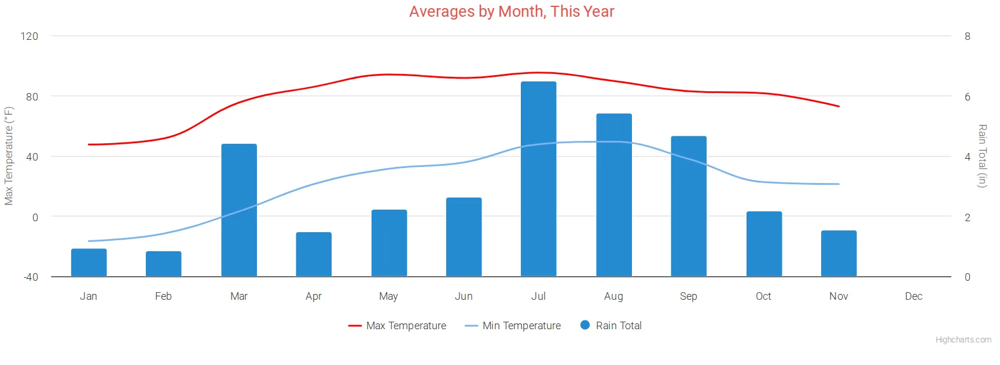

=== "ECharts"

    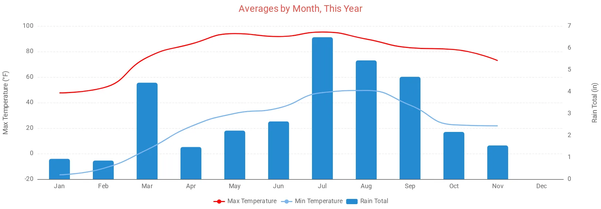

```
    [[groupbymonth]]
        title = Averages by Month, This Year
        type = spline
        time_length = year
        aggregate_type = max
        aggregate_interval = 86400
        gapsize = 86400
        xAxis_groupby = month
        xAxis_categories = 'Jan', 'Feb', 'Mar', 'Apr', 'May', 'Jun', 'Jul', 'Aug', 'Sep', 'Oct', 'Nov', 'Dec'
        [[[outTemp]]]
            zIndex = 2
            name = Max Temperature
            color = red
        [[[outTemp_min]]]
            name = Min Temperature
            observation_type = outTemp
            aggregate_type = min
            zIndex = 2
        [[[rainTotal]]]
            name = Rain Total
            type = column
            yAxis = 1
            zIndex = 0
            color = "#268bd2"
```

## Wind rose { #wind-rose }

A round chart with a wedge for each of 16 compass directions. The length of each wedge is the share of time the wind blew from that direction, split into 7 colored speed groups (Beaufort 0 to 6 and above). Point at a wedge to see the numbers.

=== "Highcharts"

    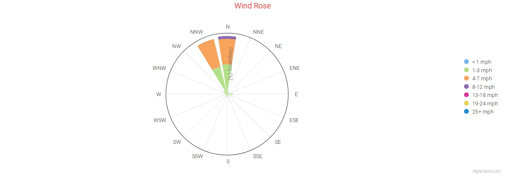

=== "ECharts"

    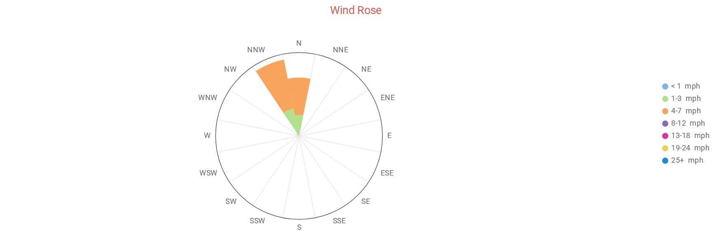

```
    [[roseplt]]
        title = Wind Rose
        time_length = week
        [[[windRose]]]
```

To change the colors, set `beauford0` (calmest) to `beauford6` (strongest) under `[[[windRose]]]`, for example `beauford0 = "#7cb5ec"`. (The spelling `beauford` is what the skin reads.) `legend = false` on the chart hides the list of speed groups.

## Hays chart { #hays-chart }

An emulation of the Mount Washington Observatory's wind chart. The hours of the day go around the circle, and the band between the highest wind speed and the highest gust in each period goes out from the middle. It needs only `[[[haysChart]]]`; it reads `windSpeed` and `windGust` itself.

=== "Highcharts"

    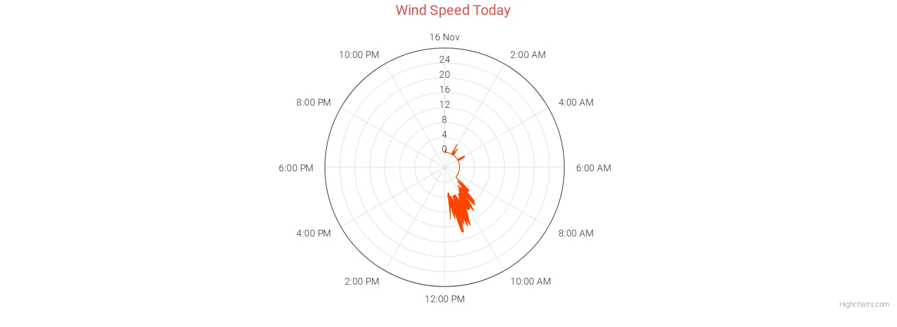

=== "ECharts"

    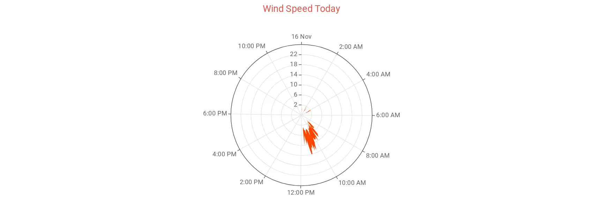

```
    [[haysplt]]
        title = Wind Speed Today
        time_length = today
        [[[haysChart]]]
            color = "#ff4500"
            yAxis_softMax = 25
```

`color` sets the color of the band. `yAxis_softMax` keeps the scale at least this high, so quiet days don't look stormy. Stronger wind still fits.

## Temperature ranges

The `weatherRange` observation draws the low and high of each day as a bar, colored by the day's average temperature. `range_type` says which observation to use.

=== "Highcharts"

    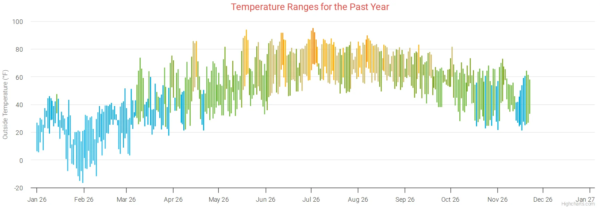

=== "ECharts"

    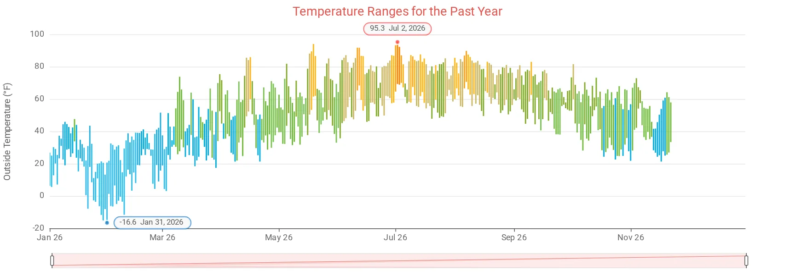

```
    [[rangebars]]
        title = Temperature Ranges for the Past Year
        time_length = year
        tooltip_date_format = "LL"
        [[[weatherRange]]]
            range_type = outTemp
```

With ECharts, the year's highest and lowest days are marked with a label.

## Temperature band

The same with `area_display = 1`: a shaded band instead of bars.

=== "Highcharts"

    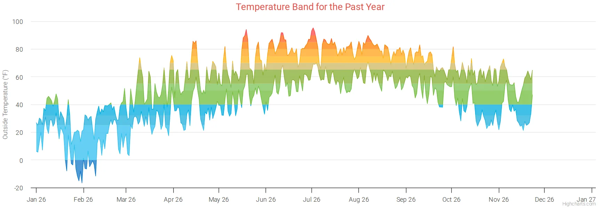

=== "ECharts"

    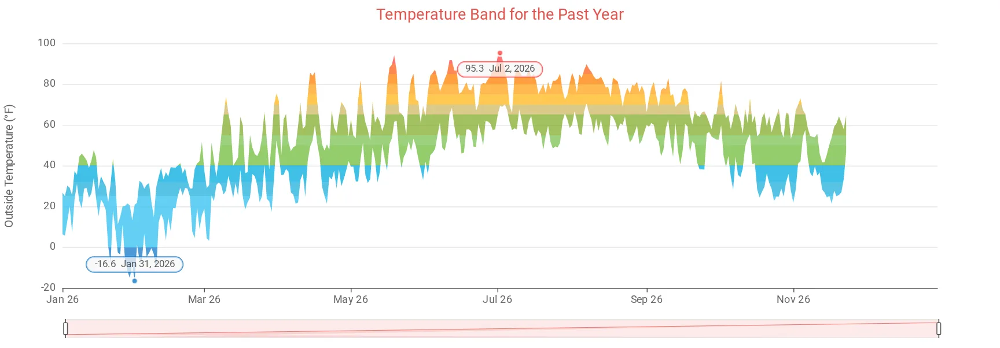

```
    [[rangearea]]
        title = Temperature Band for the Past Year
        time_length = year
        tooltip_date_format = "LL"
        [[[weatherRange]]]
            range_type = outTemp
            area_display = 1
```

## Temperature radial

The same with `polar = true`: the year goes around the circle. Inspired by the [Highcharts weather radials](https://www.highcharts.com/blog/tutorials/209-the-art-of-the-chart-weather-radials/).

=== "Highcharts"

    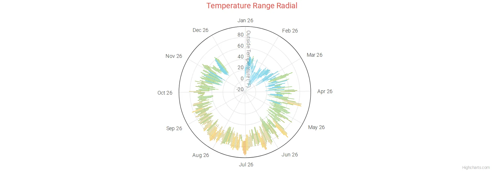

=== "ECharts"

    

```
    [[rangepolar]]
        title = Temperature Range Radial
        time_length = year
        tooltip_date_format = "LL"
        [[[weatherRange]]]
            range_type = outTemp
            polar = true
```

See [weatherRange](graphs-conf.md#weatherrange) for all its settings. For another year, change the time range, for example `time_length = year_specific` with `year_specific = 2018`.

## Gauge { #gauge-chart }

A gauge shows a single value, the most recent one in the chart's time range, on a dial. It suits readings with a clear range, like humidity. The scale runs from 0 to 100 unless you set `yAxis_min` and `yAxis_max`. `rounded = 1` gives the ring round ends.

=== "Highcharts"

    

=== "ECharts"

    

```
    [[humgauge]]
        title = Humidity
        type = gauge
        [[[outHumidity]]]
            rounded = 1
            color = "#f7a35c"
```

## Gauge with colors by value

Set `colors_enabled = 1` and up to 7 colors, each with the value where it starts (`color1` with `color1_position`, and so on). The gauge uses the highest color whose position the value has reached; `color1` is used below all positions.

=== "Highcharts"

    

=== "ECharts"

    

```
    [[gustgauge]]
        title = Top gust today
        type = gauge
        time_length = today
        aggregate_type = max
        aggregate_interval = day
        [[[windGust]]]
            rounded = 1
            colors_enabled = 1
            color1_position = 3
            color1 = "#1278c8"
            color2_position = 7
            color2 = "#1fafdd"
            color3_position = 12
            color3 = "#71bc3c"
            color4_position = 20
            color4 = "#ffae00"
            color5_position = 30
            color5 = "#ff7f00"
            color6_position = 40
            color6 = "#ff4500"
            color7_position = 50
            color7 = "#9f00c5"
            yAxis_min = 0
            yAxis_max = 70
```

This one shows the day's top gust instead of the latest reading: `time_length = today` with `aggregate_type = max` and `aggregate_interval = day`. Combine those three the same way for a low, an average, or a week.

You can also give each color a word to show under the number instead of the unit, with `color1_label`, `color2_label` and so on (for example `color4_label = "Breezy"`).

**Gauge size and thickness (Highcharts).** The skin draws the gauge with `radius = "100%"` and `innerRadius = "60%"`. You can change them under the observation, as percentages in quotes. Since Highcharts 13 (Belchertown 3.0), a plain number such as `innerRadius = 60` means 60 **pixels**, not 60 percent. ECharts keeps its own ring size.

## Air quality gauge { #air-quality-gauge }

```
    [[aqiplt]]
        title = Air Quality Index
        [[[aqiChart]]]
```

A gauge of the current US air quality index (0 to 500), colored by the US EPA categories, from green for good to maroon for hazardous, with the category name under the number. It works with both chart libraries. It needs, in `[[[Extras]]]` in `weewx.conf`:

```
            forecast_enabled = 1
            aqi_enabled = 1
```

With an Xweather key, the value comes from Xweather (the nearest reporting station). Otherwise it comes from Open-Meteo, free and with no key. The category names are labels you can translate: `aqi_good`, `aqi_moderate`, `aqi_usg`, `aqi_unhealthy`, `aqi_very_unhealthy`, `aqi_hazardous`.

## Data from another database { #using-data_binding }

If some of your data is in a separate weewx database (a lightning detector or an SDR receiver logging on its own, for example), set `data_binding` to that database's binding from `weewx.conf`. The names in triple brackets must be columns in that database.

```
    [[lightning_binding_test]]
        title = Lightning
        data_binding = lightning_binding
        time_length = year
        aggregate_type = avg
        aggregate_interval = day
        gapsize = 86400
        yAxis_label = "Lightning distance"
        [[[distance_km]]]
            name = Lightning Distance (km)
            type = column
        [[[distance_mi]]]
            name = Lightning Distance (mi)
            type = column
```

## More

* [Charts on your own pages](custom-pages.md): a chart on the About page or a home page block, or one you write yourself.
* [graphs.conf reference](graphs-conf.md): every setting, time ranges, grouping and axis labels.
