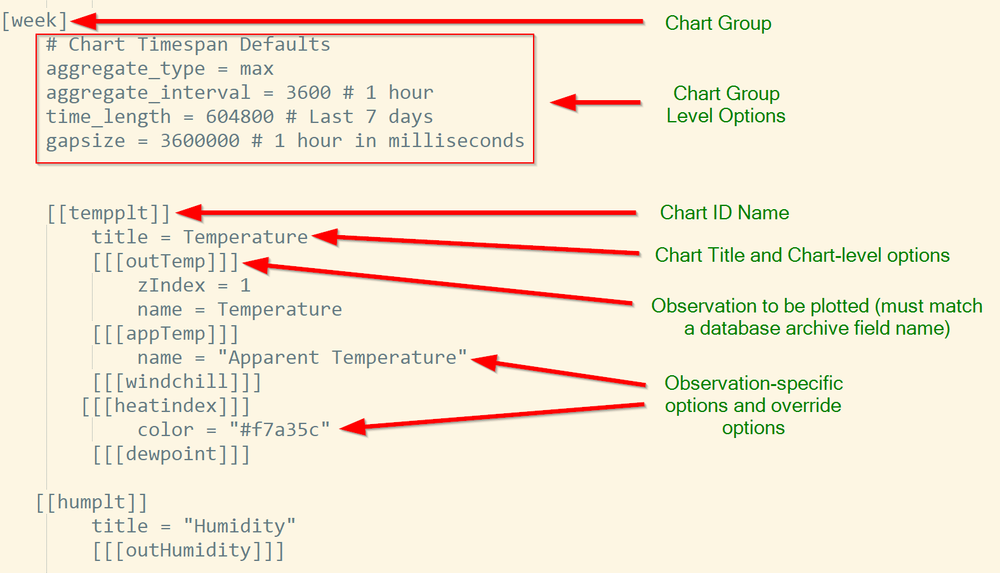

# graphs.conf reference

This page explains how the charts in the Belchertown skin are set up, for Belchertown 3.0 (weewx 5). Every chart on your home page and on the Graphs page comes from one file, `graphs.conf`. This page tells you where that file is, how it is laid out, and every setting it accepts.

If you only want to add a chart or two, start with the chart builder in the first section. It writes the settings for you.


## The easy way: the chart builder

Belchertown 3.0 comes with a chart builder. It is a page on your own website where you pick what to plot, see the chart drawn from your own station's data, and copy the matching `graphs.conf` text. You don't need to read the rest of this page to use it.

1. Open `chart-builder/` on your site. For example, if your site is `https://www.example.com/`, open `https://www.example.com/chart-builder/`. If your weather pages live in a folder, add the folder, for example `https://www.example.com/weather/chart-builder/`. The page isn't in the menu, so bookmark it.
2. Give the chart a title. Choose the kind of chart, how much time it covers and how much detail.
3. Under Lines, choose what to plot. Add a line puts more on the same chart.
4. Under Where it goes, pick the page of charts it belongs on, or A new page of charts.
5. Press Copy and follow the steps shown under the text.

The chart builder only reads your data. It can't change anything on your server. Its data file is refreshed once an hour. If the page says it is turned off, check that `chart_builder_enabled` is not set to 0.

[Chart builder](chart-builder.md) has the same steps with a screenshot.

The chart builder covers the common cases: lines, areas and columns over a day, week, month or year. For anything else on this page (gauges, wind roses, grouping by month, custom time ranges), edit `graphs.conf` by hand as described below. You can also start with the chart builder's text and add settings from this page to it.

## Where graphs.conf is

The skin ships with a file called `graphs.conf.example`. As long as there is no `graphs.conf`, the skin uses `graphs.conf.example` and you get the standard charts.

To change the charts, make your own copy called `graphs.conf` in the same folder. The skin will then read your copy instead, and upgrades of the skin will not overwrite it.

Where the folder is depends on how you installed weewx:

| How weewx was installed | Belchertown skin folder |
| --- | --- |
| Package (`apt`, `yum`, `dnf`) | `/etc/weewx/skins/Belchertown` |
| `pip`, or run from a git checkout | `~/weewx-data/skins/Belchertown` |

To make your copy:

1. Open the skin folder in your file manager, or in a terminal window go there with `cd`, for example `cd /etc/weewx/skins/Belchertown`.
2. Copy `graphs.conf.example` to `graphs.conf`. In a terminal window: `sudo cp graphs.conf.example graphs.conf` (leave out `sudo` for a `pip` install).
3. Open `graphs.conf` in a text editor and make your changes.

You don't need to restart weewx after changing `graphs.conf`. The charts change at the next report (usually every 5 minutes). To see the change right away, run:

```
weectl report run
```

**If your charts disappear** after an edit, there is a mistake in the file. Undo your last change. If you can't find the mistake, delete `graphs.conf` and make a fresh copy of `graphs.conf.example`.

## How graphs.conf is organized

### The four levels

`graphs.conf` uses square brackets to put settings inside each other. The number of brackets says which level a line belongs to. Lines that start with `#` are comments and are ignored.

1. **Global defaults** (no brackets, at the very top of the file). Every chart uses these unless it says otherwise.
2. **Chart group** (one bracket, like `[day]`). A chart group is one page of charts. Each chart group becomes one button on the Graphs page and one data file (`json/day.json`). The skin ships with five: `[homepage]` (the charts on the home page), `[day]`, `[week]`, `[month]` and `[year]`. You can rename, remove or add groups.
3. **Chart** (two brackets, like `[[chart1]]`). One chart on the page. The name inside the brackets is an ID for the chart and can be anything without spaces, as long as it is unique within its group. Charts show in the order they appear in the file.
4. **Observation** (three brackets, like `[[[outTemp]]]`). One line, area or set of columns on the chart. The name must match a column in your weewx database exactly, upper and lower case included (`outTemp`, `barometer`, `windSpeed`), or be one of the skin's [special observations](#special-observations).

Some Highcharts options need a fourth or fifth bracket level under an observation, such as `[[[[marker]]]]`. See [Highcharts series options](#highcharts-series-options).



### Settings are inherited

A setting written at a higher level is used by everything below it, unless something lower sets it again. For example, `time_length = today` in the `[day]` group applies to every chart in that group. A chart that says `time_length = week` uses a week instead, and only that chart changes.

Not every setting works at every level. Each setting in the reference sections below says where it goes.

### A complete example

This is the top of `graphs.conf.example` (the global defaults) and its `[day]` group, copied exactly. The lines starting with `#` are comments.

```
# Global Chart Defaults
# These are fallback options that charts will use if an option is not defined. 
aggregate_type = None
time_length = 90000 # Last 25 hours
type = line
colors = "#7cb5ec, #b2df8a, #f7a35c, #8c6bb1, #dd3497, #e4d354, #268bd2, #f45b5b, #6a3d9a, #33a02c"
tooltip_date_format = "LLL"

[day]
    # Chart Timespan Defaults
    title = "Today"
    show_button = true
    button_text = "Day"
    time_length = today
    tooltip_date_format = "LLL"
    gapsize = 300 # This should be your archive_interval from weewx.conf

    [[chart1]]
        title = Temperature
        [[[outTemp]]]
            zIndex = 1
#            name = Temperature
        [[[windchill]]]
        [[[heatindex]]]
            color = "#f7a35c"
        [[[dewpoint]]]
            color = purple
    
    [[chart2]]
        # The combined Wind Chart works best in this configuration
        title = Wind Speed and Direction
        yAxis_min = 0
        [[[windDir]]]
            zIndex = 1
            yAxis = 1
            yAxis_max = 360
            lineWidth = 0
            [[[[marker]]]]
                enabled = true
            [[[[states]]]]
                [[[[[hover]]]]]
                        lineWidthPlus = 0
        [[[windGust]]]
        [[[windSpeed]]]
            zIndex = 2
    
    [[chart3]]
        title = Rain
        [[[rainRate]]]
            yAxis = 1
        [[[rainTotal]]]
#            name = Rain Total
    
    [[chart4]]
        title = Barometer
        type = spline
        [[[barometer]]]
            color = "#BECC00"
```

Reading it from the top:

- The global defaults say: no averaging, 25 hours of data, line charts, the standard colors, and a date format for the tooltips.
- `[day]` is the page titled "Today", with a button labeled "Day" on the Graphs page. Its charts show today since midnight (`time_length = today`), and a gap of more than 300 seconds in the data shows as a gap in the line.
- `[[chart1]]` is a temperature chart with four lines. Outside temperature is drawn on top (`zIndex = 1`). Heat index and dew point have their own colors.
- `[[chart2]]` shows wind speed and gust as lines, and wind direction as dots on a second scale on the right (`yAxis = 1`).
- `[[chart3]]` shows the rain total for the day and the rain rate on the right-hand scale.
- `[[chart4]]` is a smooth line (`spline`) of the barometer.

The other groups in `graphs.conf.example` (`[homepage]`, `[week]`, `[month]`, `[year]`) follow the same pattern. `[week]`, `[month]` and `[year]` add `aggregate_type` and `aggregate_interval` so a long time range isn't drawn from every single record.

## Chart settings in weewx.conf

A few settings about charts are not in `graphs.conf`. They go in `weewx.conf`, in the `[[[Extras]]]` part of the `[[Belchertown]]` section. Restart weewx after changing them.

| Setting | Default | What it does |
| --- | --- | --- |
| `highcharts_enabled` | 1 | 0 hides all charts. |
| `highcharts_homepage_graphgroup` | "homepage" | Which chart group the home page shows. Set it to `day` to show the same charts as the Today page, without copying them into `[homepage]`. |
| `graph_page_default_graphgroup` | "day" | Which chart group the Graphs page opens with. `"all"` shows them all. |
| `graph_page_show_all_button` | 1 | Adds an "All" button on the Graphs page that shows every chart. |
| `highcharts_decimal` | "auto" | The decimal point in charts. `"auto"` uses your server's locale. |
| `highcharts_thousands` | "auto" | The thousands separator in charts. `"auto"` uses your server's locale. |
| `chart_builder_enabled` | 1 | Writes the data for the chart builder once an hour. 0 turns it off. |

For example:

```
[StdReport]
    [[Belchertown]]
        [[[Extras]]]
            highcharts_homepage_graphgroup = day
```

All skin options are listed under [All skin options](../options.md).

Charts follow the skin's light or dark theme, not the dark mode setting of the visitor's phone or computer. When a visitor presses the units button (°F or °C), every chart switches units too. See [Units button](../customize.md#units-button-f-or-c).

## Default color palette

These are the colors the skin gives to the lines on a chart, in this order, when you don't choose one yourself. They were picked to be easy to see on both the light and the dark theme. Black, for example, is left out because it disappears on the dark theme.

| Line | Color | Hex code |
| --- | --- | --- |
| 1 | Blue | `#7cb5ec` |
| 2 | Light green | `#b2df8a` |
| 3 | Orange | `#f7a35c` |
| 4 | Purple | `#8c6bb1` |
| 5 | Pink | `#dd3497` |
| 6 | Yellow | `#e4d354` |
| 7 | Dark blue | `#268bd2` |
| 8 | Red | `#f45b5b` |
| 9 | Dark purple | `#6a3d9a` |
| 10 | Dark green | `#33a02c` |

When you set a color for a line yourself with [color](#color), one of these is a safe choice. To change the whole palette for a chart group, see [colors](#colors).

## Special observations

These names go in triple brackets like a database column, but they are made by the skin.

### rainTotal

The weewx `rain` column holds the rain counted in each archive record, which on most stations is the bucket tips since the last record. A chart of `rain` shows small spikes when rain fell, not how much fell in total.

`rainTotal` adds the rain up from the start of the chart, so the line climbs as the rain adds up. On a "today" chart it ends at today's rain total. Rain that fell before the start of the chart is not counted.

```
    [[rainchart]]
        title = Rain
        [[[rainRate]]]
            yAxis = 1
        [[[rainTotal]]]
            name = Rain Total
```

When the chart has an [aggregate_interval](#aggregate_interval), `rainTotal` always adds up (`sum`) each interval, and `rainRate` always takes the highest value (`max`), whatever `aggregate_type` says.

### weatherRange

`weatherRange` draws the low and high of an observation for each day as a bar from low to high. Inspired by the [Highcharts weather radials](https://www.highcharts.com/blog/tutorials/209-the-art-of-the-chart-weather-radials/). For outside temperature, each bar is colored by the day's average temperature.

You must say which observation to use with `range_type`, which must be a column in your database. The bars are one per day unless you set an `aggregate_interval`.

```
[weatherRadialGraphGroup]
    title = Temperature Range Radial
    show_button = true
    button_text = Weather Radial
    time_length = year

    [[radialChartName]]
        title = This Year
        css_class = "weatherRadial"
        [[[weatherRange]]]
            range_type = outTemp
```


Settings that only `weatherRange` reads (under `[[[weatherRange]]]`):

| Setting | What it does |
| --- | --- |
| `range_type` | Required. The observation to show, for example `outTemp`. |
| `polar = true` | Draws the bars around a circle instead of along a line. |
| `area_display = 1` | Draws a shaded band instead of bars. Does not work together with `polar`. |
| `color` | One color for every bar, instead of coloring by temperature. |

Round version:

```
    [[radialChartName]]
        title = This Year
        css_class = "weatherRadial"
        [[[weatherRange]]]
            range_type = outTemp
            polar = true
```


Shaded band version:

```
    [[radialChartName]]
        title = Temperature Ranges for Past Year
        [[[weatherRange]]]
            range_type = outTemp
            area_display = 1
```


For another year, change the time range, for example `time_length = year_specific` with `year_specific = 2018`. See [Time ranges with examples](#time-ranges-with-examples).

### windRose

A wind rose shows how often the wind blew from each of 16 directions, split into 7 speed groups. See [Wind rose](gallery.md#wind-rose) for an example and the colors you can change.

### haysChart

A round chart of wind speed and gusts by time of day, after the Mount Washington Observatory's chart. See [Hays chart](gallery.md#hays-chart).

### aqiChart

A gauge of the current air quality index (US AQI). It needs the forecast turned on (the default) and `aqi_enabled = 1` in `[[[Extras]]]` in `weewx.conf`. See [Air quality gauge](gallery.md#air-quality-gauge).

## Reference: chart group settings

These go directly under a chart group name, like `[day]`, before its first chart.

### title

```
[day]
    title = "Today"
```

The heading of the page on the Graphs page. If it is missing, the group name is used. A chart that has no title of its own also uses this one.

### show_button

```
    show_button = true
```

Shows a button for this group on the Graphs page. It must be the word `true`; `1` or `yes` will not show the button. Leave it out (or set `false`) for a group that is only used on the home page or on your own page.

### button_text

```
    button_text = "Day"
```

The text on the group's button on the Graphs page. If it is missing, the group name is used.

### page_content

Text or HTML shown on the Graphs page under the page's title and above the charts. It can be one line:

```
    page_content = "This page shows all the readings from <b>this week</b>."
```

Or several lines, between three double quotes:

```
    page_content = """This is the 2019 bomb cyclone which hit the Northeast.
    <br><br>
    <b>To learn more, <a href="https://en.wikipedia.org/wiki/Explosive_cyclogenesis">click here</a>.</b>
    """
```

### generate

```
    generate = daily
```

Makes the group's data only once in a while instead of at every report. Useful for a slow group such as a year of data, which doesn't change much in 5 minutes. Accepted values: `hourly`, `daily`, `weekly`, `monthly`, `yearly`, or a number of seconds.

The skin uses the time of the group's data file (`json/<group>.json`) to decide, so it keeps working across restarts of weewx. If the file doesn't exist yet, it is made at the next report.

```
[dayonly]
    generate = daily
    title = Generate only daily
    show_button = true
    button_text = Today Only
    time_length = today
    gapsize = 300

    [[chart1]]
        title = Temperature
        [[[outTemp]]]
            zIndex = 1
            name = Temperature
        [[[windchill]]]
        [[[heatindex]]]
        [[[dewpoint]]]
```

### colors

```
    colors = "#7cb5ec, #b2df8a, #f7a35c, #8c6bb1, #dd3497, #e4d354, #268bd2, #f45b5b, #6a3d9a, #33a02c"
```

The colors given to lines in order, for the charts in this group. Put it at the top of the file to change it for every group. Keep the double quotes around the whole list: without them the setting is read as a list and the charts don't load. The default is shown above and in [Default color palette](#default-color-palette).

### credits

```
    credits = "Your Website Name"
```

The small text in the bottom corner of each chart. By default it is the Highcharts credit.

### credits_url

```
    credits_url = "https://example.com"
```

Where the credit text links to.

### credits_position

```
    credits_position = '{"align": "left", "x": 15}'
```

Moves the credit text. The value is JSON inside single quotes, using the Highcharts [credits.position](https://api.highcharts.com/highcharts/credits.position) settings `align`, `verticalAlign`, `x` and `y`. The example moves it to the left side.

## Reference: chart settings

These go under a chart, like `[[chart1]]`. Most of them can also go on the chart group, to apply to every chart in it.

### title and subtitle

```
    [[chart1]]
        title = Temperature
        subtitle = "Since midnight"
```

The chart's heading, and an optional smaller line under it. The title links to the chart, so visitors can share a link straight to one chart.

### type

```
        type = spline
```

The kind of chart. Default `line`. Common values: `line`, `spline` (smooth line), `area`, `areaspline`, `column`, `scatter`, and `gauge` (see [Gauge chart](gallery.md#gauge-chart)). Other Highcharts types may work; see the [Highcharts chart types](https://api.highcharts.com/highcharts/series).

`type` can also be set on a single observation to mix kinds on one chart, for example a `column` of rain under a `line` of temperature.

### gapsize

```
    gapsize = 300
```

A gap between two readings longer than this many **seconds** is drawn as a break in the line, so you can see when the station was offline. Default 300 (5 minutes).

Set it to match how far apart the points on the chart are:

| Chart | gapsize |
| --- | --- |
| Every record, archive interval of 5 minutes | `300` |
| `aggregate_interval = 3600` (one point per hour) | `3600` |
| `aggregate_interval = 86400` (one point per day) | `86400` |

`gapsize = 0` turns gaps off; the line is drawn straight across missing data.

Put `gapsize` on the chart group or the chart. If you put it under an observation instead, the number is read as **milliseconds** (seconds × 1000), so `3600000` there means one hour. Older versions of this page gave all gapsize values in milliseconds; at the group and chart level that is no longer right.

### connectNulls

```
        connectNulls = true
```

Draws the line straight across missing readings. Use this for a sensor that reports less often than the rest, for example an energy meter that reports once an hour on a 5-minute chart. Default `false`.


### tooltip_date_format

```
    tooltip_date_format = "dddd LL"
```

How the date and time look in the box that appears when you point at a chart. Can be set at the top of the file, on a group or on a chart. If it is set nowhere, the skin uses `LLLL`. See [Tooltip date format](#tooltip-date-format) for the codes.

### legend

```
        legend = false
```

`false` hides the list of line names under the chart. Default `true`.

### exporting

```
        exporting = 1
```

Adds a menu button to the chart so visitors can save it as an image or PDF, or print it. Default off.

### width

```
        width = 100%
```

The width of the chart, as a percentage (`100%`) or in pixels (`600px`). A chart with its own width takes a row of the page to itself. `100%` means the full width of the area holding the charts, not of the screen.

### height

```
        height = 600px
```

The height of the chart, in pixels or as a percentage.

### css_class

```
        css_class = "weatherRadial"
```

Adds one or more CSS class names (separated by spaces) to the chart's box, so you can style it in `custom.css`.

### xAxis_groupby

```
        xAxis_groupby = month
```

Groups the data by `hour`, `day`, `month` or `year` instead of drawing it along a timeline. For example, `month` adds up (or averages) all the Januaries together, all the Februaries, and so on. See [Grouping by month or year](#grouping-by-month-or-year) for what each value means and a full example.

### xAxis_categories

```
        xAxis_categories = Jan, Feb, Mar, Apr, May, Jun, Jul, Aug, Sep, Oct, Nov, Dec
```

The labels along the bottom of a grouped chart, in order. Used with `xAxis_groupby`. Without it, the chart labels the groups with the numbers it gets from the database (`01`, `02` … for months, `2019`, `2020` … for years). See [Grouping by month or year](#grouping-by-month-or-year).

## Reference: time settings

These choose how much time a chart covers. They can go at the top of the file, on a chart group, on a chart or on a single observation.

### time_length

```
    time_length = today
```

How much time the chart covers. You can use a name or a number of seconds.

**Names.** These follow the calendar:

| Value | Covers |
| --- | --- |
| `today` | Today, from midnight. Note it is `today`, not `day`. |
| `week` | This calendar week. The first day of the week is `week_start` in the `[Station]` section of `weewx.conf` (6 = Sunday, the weewx default; 0 = Monday). |
| `month` | This calendar month, from the 1st. |
| `year` | This calendar year, Jan 1 to Dec 31. The rest of the year shows as empty space. |
| `year_to_now` | Jan 1 of this year up to now, with no empty space after today. |
| `days_ago` | One whole day, [time_ago](#time_ago) days back. `time_ago = 1` is yesterday. |
| `weeks_ago` | One whole calendar week, `time_ago` weeks back. |
| `months_ago` | One whole calendar month, `time_ago` months back. |
| `years_ago` | One whole calendar year, `time_ago` years back. |
| `hour_ago_to_now` | The last `time_ago` hours up to now. |
| `day_ago_to_now` | The last `time_ago` days up to now. |
| `week_ago_to_now` | The last `time_ago` weeks up to now. |
| `month_ago_to_now` | The last `time_ago` months up to now. Use with an `aggregate_type` and `aggregate_interval` to keep the chart small. |
| `year_ago_to_now` | The last `time_ago` years up to now. Use with an `aggregate_type` and `aggregate_interval`. |
| `timestamp_ago_to_now` | From the moment given in `time_ago` (a Unix timestamp, see [timespan_start and timespan_stop](#timespan_start-and-timespan_stop)) up to now. |
| `day_specific` | One given day. Needs `day_specific`, `month_specific` and `year_specific`. |
| `month_specific` | One given month. Needs `month_specific` and `year_specific`. |
| `year_specific` | One given year. Needs `year_specific`. |
| `timespan_specific` | From `timespan_start` to `timespan_stop`. |
| `all` | Everything in your database. |

**Seconds.** A number is a rolling window that ends now:

| Value | Covers |
| --- | --- |
| `86400` | The last 24 hours. |
| `90000` | The last 25 hours. This is the global default in `graphs.conf.example`. |
| `604800` | The last 7 days. Used by `[week]` in `graphs.conf.example`. |
| `2592000` | The last 30 days. Used by `[month]` in `graphs.conf.example`. |
| `31536000` | The last 365 days. |

If `time_length` is set nowhere, a chart covers the last 86400 seconds (24 hours). `graphs.conf.example` sets 90000 at the top, so with the shipped file it is 25 hours.

### time_ago

```
    time_ago = 2
```

How far back to go, for the `time_length` values that end in `_ago` or `_ago_to_now`. Default 1. With `timestamp_ago_to_now` it is a Unix timestamp instead.

### day_specific, month_specific and year_specific

```
    time_length = day_specific
    day_specific = 31
    month_specific = 10
    year_specific = 2017
```

The day of the month, the month (1 to 12) and the year, for `time_length = day_specific`, `month_specific` or `year_specific`. Give all the ones the chosen `time_length` needs; the example shows October 31, 2017.

### timespan_start and timespan_stop

```
    time_length = timespan_specific
    timespan_start = 1571198400
    timespan_stop = 1571371199
```

The start and end of the chart for `time_length = timespan_specific`, as Unix timestamps (seconds since January 1, 1970, UTC). A website such as [epochconverter.com](https://www.epochconverter.com/) turns a date and time into a timestamp. Both are required.

### start_at_midnight

```
    start_at_midnight = true
```

Moves the start of the chart back to midnight of its first day. Works with the `_ago_to_now` values, `timestamp_ago_to_now`, and a number of seconds. Default `false`.

```
[timetestchart]
    title = Time Test Chart
    show_button = true
    button_text = Time Test Chart
    gapsize = 300

    [[chart1]]
        title = Temperature
        time_length = day_ago_to_now
        time_ago = 1
        start_at_midnight = true
        [[[outTemp]]]
```

This shows yesterday from midnight up to now.

### start_at_whole_hour

```
        start_at_whole_hour = true
```

Moves the start of the chart back to the start of the hour, so a chart that would start at 6:25 starts at 6:00. Use it with `aggregate_interval = hour` for an hourly chart. Default `false`.

```
    [[hourlyrain]]
        title = Rain per hour
        aggregate_interval = hour
        start_at_whole_hour = true
        gapsize = 3600
        [[[rain]]]
            aggregate_type = sum
            type = column
        [[[rainRate]]]
            yAxis = 1
            aggregate_type = max
```

### start_at_beginning_of_month

```
        start_at_beginning_of_month = true
```

Moves the start of the chart back to the first of its month, so a chart that would start on June 15 starts on June 1. Use it with `aggregate_interval = month` for a monthly chart. See [Monthly climate chart](gallery.md#monthly-climate-chart). Default `false`.

## Reference: data settings

These decide which data is read and how it is combined. They can go at the top of the file, on a chart group, on a chart or on a single observation.

### data_binding

```
        data_binding = lightning_binding
```

Reads the data from another weewx database instead of your main one, for example a separate lightning or SDR database you set up in `weewx.conf`. The names in triple brackets must then be columns in that database. Default: the `data_binding` of the `[StdReport]` section, normally `wx_binding`. See [Using data_binding](gallery.md#using-data_binding).

### observation_type

```
        [[[outTemp_min]]]
            observation_type = outTemp
```

The database column to read, when the name in brackets is something else. You need this to show the same observation twice on one chart, because two observations on a chart can't have the same name. This shows the high and low temperature for each day:

```
        [[[outTemp]]]
            name = Max Temperature
            color = red
        [[[outTemp_min]]]
            name = Min Temperature
            observation_type = outTemp
            aggregate_type = min
            color = "#7cb5ec"
```

### aggregate_type

```
    aggregate_type = max
```

Combines the readings in each [aggregate_interval](#aggregate_interval) into one point. Values: `None` (no combining, every record is drawn), `avg`, `sum`, `min`, `max`. Other weewx aggregate types such as `count` or `last` also work. Default `None`.

When you set `aggregate_type`, you also need `aggregate_interval`, except on a grouped chart (see [Grouping by month or year](#grouping-by-month-or-year)).

### aggregate_interval

```
    aggregate_interval = 3600
```

The length of each combined point. A number of seconds (`3600` for one hour, `86400` for one day), or one of the words `hour`, `day`, `week`, `month`, `year`. weewx's short forms such as `2h`, `30M` (30 minutes) or `1d` also work.

### average_type

```
        aggregate_type = avg
        average_type = sum
```

Only for grouped charts (with `xAxis_groupby`). With `aggregate_type = avg`, it says what to average: `sum` (the average of each month's total), `max` (the average of the daily highs) or `min` (the average of the daily lows). For example, `xAxis_groupby = month` with `aggregate_type = avg` and `average_type = sum` on `rain` gives the average rain for each month of the year across all the years in the database. See [Grouping by month or year](#grouping-by-month-or-year).

### unit

```
        [[[barometer]]]
            unit = mbar
```

Shows this observation in a different unit than the rest of your site. Use a weewx unit name, such as `degree_C`, `degree_F`, `mbar`, `inHg`, `km_per_hour`, `mile_per_hour`, `mm` or `inch`.

### mirrored_value

```
            mirrored_value = true
```

Draws the values below the zero line instead of above it, while the labels still show them as positive numbers. See [Mirrored stacked column chart](gallery.md#mirrored-stacked-column-chart).

## Reference: observation settings

These go under an observation, like `[[[outTemp]]]`. The ones marked "also on the chart" can go on the chart to apply to all its observations.

### name

```
            name = Temperature
```

The name of the line in the legend and in the tooltip. Without it, the skin uses the observation's label from the skin's `[Labels]`, for example "Outside Temperature" for `outTemp`.

### color

```
            color = "#f7a35c"
```

The color of this line, as a hex code in quotes (`"#f7a35c"`) or a color name (`red`, `purple`). Without it, the line gets the next color from the [palette](#default-color-palette).

### zIndex

```
            zIndex = 1
```

Which line is drawn on top when lines overlap. Higher numbers are drawn on top.

### yAxis

```
            yAxis = 1
```

`1` puts this observation on a second scale on the right side of the chart. `0` (the default) is the scale on the left. Use it when two observations are measured in different units, such as rain rate and rain total. A chart has at most these two scales.

### yAxis_label

```
            yAxis_label = "Solar radiation"
```

The words for the scale's label. The skin adds the unit in parentheses, so this gives "Solar radiation (W/m²)". Also on the chart. See [y axis labels](#y-axis-labels) for which observation's label is used and how to remove a label.

### yAxis_label_unit

```
            yAxis_label_unit = "watts"
```

Replaces the unit in the parentheses of the label. `yAxis_label_unit = ""` leaves the parentheses off. Also on the chart.

### yAxis_min and yAxis_max

```
        yAxis_min = 0
        yAxis_max = 100
```

Fixes the bottom and top of the scale. Use one or both. Also on the chart. When several observations share a scale, the last one in the chart decides, so put these on the chart or on the last observation of that scale.

### yAxis_softMin and yAxis_softMax

```
            yAxis_softMin = 50
            yAxis_softMax = 70
```

The scale shows at least this range, but grows if the data goes beyond it. Whole numbers only.

### yAxis_tickInterval

```
            yAxis_tickInterval = 0.01
```

The step between the numbers on the scale. `0.01` gives 29.90, 29.91, 29.92; `5` gives 0, 5, 10, 15. Useful for the barometer. Note the capital I in `tickInterval`: other spellings are ignored.


### yAxis_minorTicks

```
            yAxis_minorTicks = true
```

Adds small marks between the numbers on the scale.

### numberFormat

```
        [[[barometer]]]
            [[[[numberFormat]]]]
                decimals = 3
                decimalPoint = "."
                thousandsSep = ","
```

How numbers look in the tooltip and on the scale for this observation. Each of the three is optional:

- `decimals`: how many digits after the decimal point. Without it, the skin uses the format for that unit from weewx's `[Units][[StringFormats]]`.
- `decimalPoint`: the character for the decimal point.
- `thousandsSep`: the character between thousands. `""` uses none, so 1007,3 instead of 1 007,3.

Without `numberFormat`, the decimal point and thousands separator come from `highcharts_decimal` and `highcharts_thousands` (see [Chart settings in weewx.conf](#chart-settings-in-weewxconf)).


### Highcharts series options

Any setting under an observation that the skin doesn't use itself is passed on to Highcharts as a [series option](https://api.highcharts.com/highcharts/series). That means many Highcharts settings work without the skin knowing about them, for example `lineWidth`, `dashStyle`, `stacking`, `pointWidth`, `marker` or `states`. Settings that contain other settings in Highcharts get their own brackets, one level deeper each time:

```
        [[[windDir]]]
            lineWidth = 0
            [[[[marker]]]]
                enabled = true
            [[[[states]]]]
                [[[[[hover]]]]]
                    lineWidthPlus = 0
```

Numbers are passed as numbers, everything else as text. There is no guarantee every Highcharts option works with the skin's charts. If one breaks your charts, remove it.

## Time ranges with examples

Yesterday:

```
[yesterday]
    title = Yesterday
    show_button = true
    button_text = Yesterday
    time_length = days_ago
    time_ago = 1
    gapsize = 300

    [[chart1]]
        title = Temperature
        [[[outTemp]]]
            zIndex = 1
            name = Temperature
        [[[windchill]]]
        [[[heatindex]]]
        [[[dewpoint]]]
```

`weeks_ago`, `months_ago` and `years_ago` work the same way. `time_ago = 1` is last week, last month or last year; `time_ago = 3` is three back.

Last year, highs and lows by day:

```
[lastyear]
    title = Last Year
    show_button = true
    button_text = Last Year
    type = spline
    time_length = years_ago
    time_ago = 1
    aggregate_type = max
    aggregate_interval = 86400
    gapsize = 86400

    [[chart1]]
        title = Temperature
        [[[outTemp]]]
            zIndex = 1
            name = Max Temperature
            color = red
        [[[outTemp_min]]]
            name = Min Temperature
            observation_type = outTemp
            aggregate_type = min
            color = "#7cb5ec"
```

One day (Halloween 2017):

```
[halloween2017]
    title = "Halloween 2017"
    show_button = true
    button_text = "October 31, 2017"
    time_length = day_specific
    day_specific = 31
    month_specific = 10
    year_specific = 2017
    gapsize = 300

    [[chart1]]
        title = Temperature
        [[[outTemp]]]
            name = Temperature
            zIndex = 1
        [[[windchill]]]
        [[[heatindex]]]
        [[[dewpoint]]]
```

One month (August 2016), one point per day:

```
[august2016]
    title = August 2016
    show_button = true
    button_text = August 2016
    time_length = month_specific
    month_specific = 8
    year_specific = 2016
    type = spline
    aggregate_type = max
    aggregate_interval = 86400
    gapsize = 86400

    [[chart1]]
        title = Temperature
        [[[outTemp]]]
            zIndex = 1
            name = Max Temperature
            color = red
        [[[outTemp_min]]]
            name = Min Temperature
            observation_type = outTemp
            aggregate_type = min
            color = "#7cb5ec"
```

For a whole year use `time_length = year_specific` and `year_specific = 2018` the same way.

Two given days (the October 2019 bomb cyclone in New England). October 16, 2019 at midnight Eastern time is `1571198400`; October 17, 2019 at 11:59:59 PM is `1571371199`:

```
[2019bombcyclone]
    title = "2019 Bomb Cyclone"
    show_button = true
    button_text = "2019 Bomb Cyclone"
    time_length = timespan_specific
    timespan_start = 1571198400
    timespan_stop = 1571371199
    gapsize = 300

    [[barometerchart]]
        title = Barometer
        type = spline
        [[[barometer]]]
            color = "#BECC00"
```


Everything in the database: `time_length = all`.

## Grouping by month or year

Normally a chart draws its data along a timeline. With `xAxis_groupby`, the chart instead puts the data into groups and draws one point or column per group. This is how you answer questions like "which is my rainiest month?" or "how much rain fell each year?".

What each value of `xAxis_groupby` groups:

| Value | One group for each | Example labels without `xAxis_categories` |
| --- | --- | --- |
| `month` | Month of the year, across all years in the time range. All Januaries go together. | `01` … `12` |
| `year` | Year | `2019`, `2020` … |
| `day` | Day of the month (1 to 31), across all months in the time range. All 1sts go together. | `01` … `31` |
| `hour` | Hour of the day (0 to 23), across all days in the time range. | `00` … `23` |

How the values in a group are combined is set by [aggregate_type](#aggregate_type), which defaults to `sum` on a grouped chart. With `aggregate_type = avg` you can add [average_type](#average_type).

`xAxis_categories` gives the labels along the bottom, in order. Separate them with commas. Give exactly the groups your data will have: if your station started in June and the time range is one year, the months come out as June to December, so the labels must be `Jun, Jul, Aug, Sep, Oct, Nov, Dec`. If you are not sure, leave `xAxis_categories` out, look at the chart after the next report, and use the labels the database gave you as a guide. For `year`, you don't need `xAxis_categories` at all; the years come from the database.

The tooltip on a grouped chart shows the label, not a date, so `tooltip_date_format` doesn't apply.

Here is a complete group with three grouped charts. Paste it at the end of `graphs.conf`:

```
[raintotals]
    title = Rain Totals
    show_button = true
    button_text = Rain Totals
    type = column
    time_length = all

    [[rainbymonth]]
        title = Rain by month, all years added together
        xAxis_groupby = month
        xAxis_categories = Jan, Feb, Mar, Apr, May, Jun, Jul, Aug, Sep, Oct, Nov, Dec
        [[[rain]]]
            name = Rain
            aggregate_type = sum

    [[avgrainbymonth]]
        title = Average rain for each month
        xAxis_groupby = month
        xAxis_categories = Jan, Feb, Mar, Apr, May, Jun, Jul, Aug, Sep, Oct, Nov, Dec
        [[[rain]]]
            name = Average rain
            aggregate_type = avg
            average_type = sum

    [[rainbyyear]]
        title = Rain by year
        xAxis_groupby = year
        [[[rain]]]
            name = Rain
            aggregate_type = sum
```

- The first chart adds up all the rain ever recorded in each month of the year. With several years of data, it shows which month is wettest overall.
- The second chart shows the average rain for each month: the total for each January, averaged over all the Januaries, and so on.
- The third chart shows the total rain for each year.

These use `rain` rather than `rainTotal`. On a grouped chart `rainTotal` is read as `rain`, and if an `aggregate_interval` is also set (for example inherited from the group) it is always added up, which would turn the average into a total.

To limit a grouped chart to one year, change its time range, for example `time_length = year_specific` and `year_specific = 2018`, or `time_length = year` for this year.

Grouped charts read the database directly and work with SQLite and MySQL databases.

## y axis labels

Each scale (left and right) gets a label, normally the observation's name with its unit, like "Dew Point (°F)".

When several observations share a scale, **the last observation on that scale sets the label**. In this chart the left label comes from `dewpoint`, the last one:

```
    [[chart1]]
        title = Temperature
        [[[outTemp]]]
            name = Temperature
            zIndex = 1
        [[[windchill]]]
        [[[heatindex]]]
        [[[dewpoint]]]
```


To choose the label, set [yAxis_label](#yaxis_label) on the chart. It then applies to every observation, so the last one carries it too:

```
    [[chart1]]
        title = Temperature
        yAxis_label = "Temperature"
        [[[outTemp]]]
            name = Temperature
            zIndex = 1
        [[[windchill]]]
        [[[heatindex]]]
        [[[dewpoint]]]
```

This gives "Temperature (°F)". If you set `yAxis_label` on single observations instead, only the one on the last observation of each scale is shown.

To remove the label, set it to nothing on the chart:

```
    [[chart1]]
        title = Temperature
        yAxis_label = ""
        [[[outTemp]]]
        [[[dewpoint]]]
```

**An observation weewx has no unit for** (for example a column you added for a lightning counter) has no label at all, because there is no name or unit to show. Give it one with `yAxis_label`.

## Tooltip date format

The tooltip is the box that appears when you point at a chart. Its date and time are formatted with [tooltip_date_format](#tooltip_date_format), using the [Day.js format codes](https://day.js.org/docs/en/display/format). These are the same codes older versions of Belchertown used, so an existing format keeps working.

Codes that follow the visitor's language and country:

| Code | Example (US English) |
| --- | --- |
| `LT` | 8:02 PM |
| `LL` | May 31, 2019 |
| `LLL` | May 31, 2019 8:02 PM |
| `LLLL` | Friday, May 31, 2019 8:02 PM |
| `dddd LL` | Friday May 31, 2019 |

Codes for building your own format:

| Code | Gives |
| --- | --- |
| `dddd` / `ddd` | Saturday / Sat |
| `DD` / `D` | 05 / 5 (day of the month) |
| `MMMM` / `MMM` / `MM` | January / Jan / 01 |
| `YYYY` / `YY` | 2019 / 19 |
| `HH` / `H` | 14 / 14, 02 / 2 (24-hour clock) |
| `hh` / `h` | 02 / 2 (12-hour clock) |
| `mm` | 08 (minutes) |
| `A` | PM |

For example, `tooltip_date_format = "dddd DD MMM HH:mm"` gives "Wednesday 15 May 20:25", and `"MM-DD-YY"` gives "05-31-19".

```
[day]
    title = Today
    show_button = true
    button_text = Today
    time_length = today
    tooltip_date_format = "LLL"
    gapsize = 300
```


## Tips

- **More charts means slower pages.** Every chart is rebuilt from the database at every report, and visitors download its data. Long time ranges with every record are the heaviest: use `aggregate_type` and `aggregate_interval` on week, month and year charts, and [generate](#generate) for groups that don't need to change every 5 minutes. The shipped `graphs.conf.example` is a good balance.
- **A different home page.** The home page shows the `[homepage]` group. Edit that group to show different charts there than on the Today page, or set `highcharts_homepage_graphgroup = day` in `weewx.conf` to show the Today charts without keeping two copies.
- **Upper and lower case matter.** `outTemp` is not `outtemp`, and `yAxis_tickInterval` is not `yAxis_tickinterval`. A setting with the wrong case is ignored without any message.
- **A setting that doesn't seem to work** may be at the wrong level. Check the reference section for where it goes.
- **Charts from an older Belchertown.** Settings from 1.x keep working, with these changes: `gapsize` on a group or chart is in seconds, not milliseconds; the old names `yAxisLabel`, `yaxis_min`, `xaxis_groupby` and similar are no longer read (use the names on this page); and a gauge `radius` or `innerRadius` written as a plain number is now pixels (see [Gauge chart](gallery.md#gauge-chart)).

## If something goes wrong

1. **Check the browser.** Turn on debug mode: add `belchertown_debug = 1` to `[[[Extras]]]` in the `[[Belchertown]]` section of `weewx.conf` and restart weewx. Open your site, press F12 to open the browser's developer tools, and choose the Console tab. Reload the page. Each chart reports what it is building, and any error is shown there. See [Debug mode](../troubleshooting.md#debug-mode). Turn it off again afterward.
2. **Check the weewx log.** A mistake in `graphs.conf` (a missing bracket, an unknown observation) usually shows up there. On most systems: `sudo journalctl -u weewx`, or look in `/var/log/syslog`.
3. **Go back to the standard charts.** Delete `graphs.conf` (or rename it) and run `weectl report run`. If the standard charts come back, the problem is in your `graphs.conf`.

For help, ask on the [weewx-user group](https://groups.google.com/g/weewx-user), where weewx users and developers answer questions. If you have found a bug in the skin, or want to suggest a feature, open an issue on [GitHub](https://github.com/poblabs/weewx-belchertown/issues).
