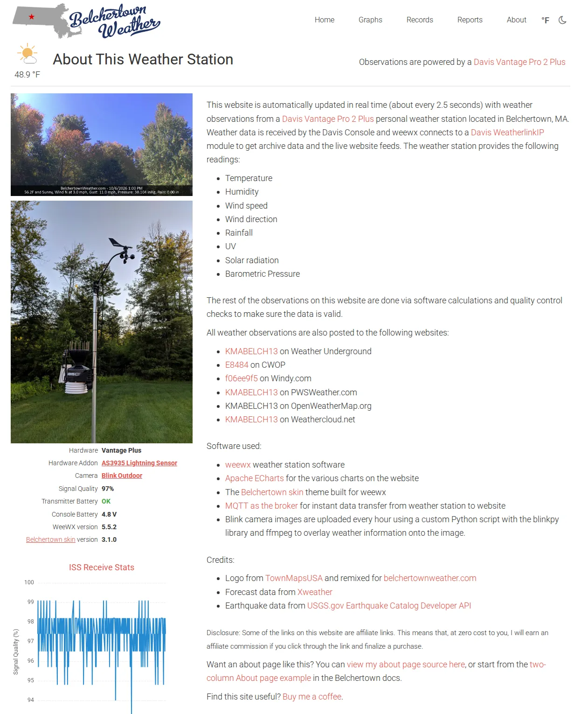
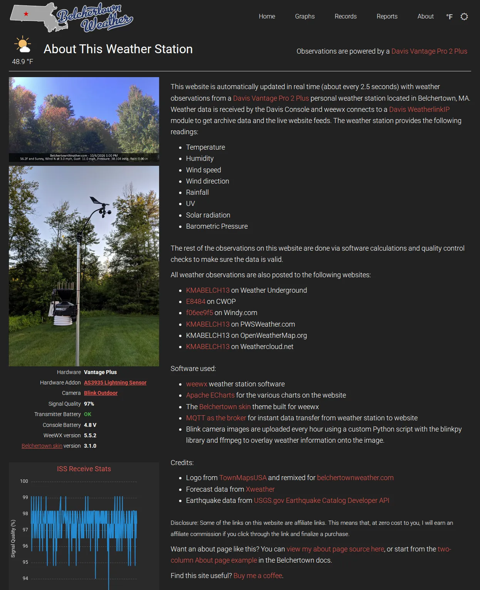
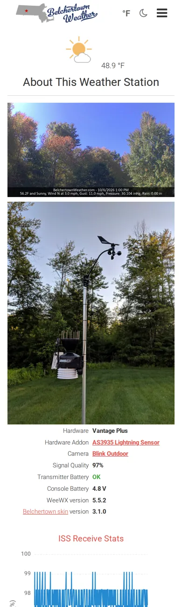

# Two-column About page

The About page of [BelchertownWeather.com](https://belchertownweather.com/about) has the station's photos, a table of live facts and two small charts on the left, and the story of the station on the right. People often ask how it's done, so here it is, ready to copy. It works with both chart libraries, in light and dark mode, and turns into one column on phones.

=== "Desktop"

    

=== "Dark mode"

    

=== "Phone"

    { width="390" }

!!! tip "See the real thing"
    The exact files behind that page, always current, are at [belchertownweather.com/source/about.txt](https://belchertownweather.com/source/about.txt): its part of `graphs.conf`, then its `about.inc`. The version below is the same layout with the station's own details taken out, so it's easier to start from.

## 1. Add the charts to graphs.conf

The two small charts on the left come from a chart group called `[about]`. Open `graphs.conf` in the Belchertown skin folder ([where is it?](../before-you-start.md#which-kind-of-weewx-you-have)) and add this at the end:

```
[about]
    show_button = false
    time_length = 172800
    gapsize = 300

    [[aboutchart1]]
        title = Temperature, Past 48 Hours
        [[[outTemp]]]

    [[aboutchart2]]
        title = Barometer, Past 48 Hours
        [[[barometer]]]
```

`show_button = false` keeps it off the Graphs page, and `time_length = 172800` is 48 hours in seconds. Chart anything you like here; the [chart gallery](../charts/gallery.md) has ideas. BelchertownWeather.com shows the signal quality of its Davis station instead, with `[[[rxCheckPercent]]]` (Davis stations only).

## 2. Make about.inc

[Download about-two-column.inc](../assets/examples/about-two-column.inc), rename it `about.inc` and put it in the Belchertown skin folder. Or create `about.inc` there and paste this in (package install shown):

```
cd /etc/weewx/skins/Belchertown
sudo nano about.inc
```

```html
--8<-- "docs/assets/examples/about-two-column.inc"
```

## 3. Make it yours

Change these parts, then wait for the next report. There's no need to restart weewx.

* **The two pictures** at the top left: your webcam and a photo of your station. Each `src="..."` is a picture's web address. Delete a line to drop that picture.
* **The facts table** fills itself in from weewx. Rows such as signal quality and the batteries only appear when your station reports them. To add a row of your own, copy a `<tr>` line: `<tr><td>Installed</td><td>May 2019</td></tr>`.
* **The text on the right:** your own words about the station, what it measures, and where else its readings go. Replace `YOURID` with your station's ID on each site, or delete a line you don't need.
* **The charts:** `aboutchart1` and `aboutchart2` must match the names in double brackets in your `[about]` group, and `showChart("about")` must match the group's name.

How it works, if you want to change the layout: the `<style>` block at the top makes two columns, one third and two thirds wide (`1fr 2fr`), and switches to one column on screens narrower than 800 pixels. Make it `1fr 1fr` for two equal columns.

??? note "Coming from an older About page?"
    Older two-column About pages used Bootstrap's `row`, `col-sm-4` and `col-sm-8`. Belchertown 3 still shows those correctly, but the layout above does the same with a few lines of its own and nothing extra to load. Copy your text into the right-hand column and your pictures and table into the left-hand one.

More about the About page and weewx tags: [About and Records pages](../customize.md#about-and-records-pages).
