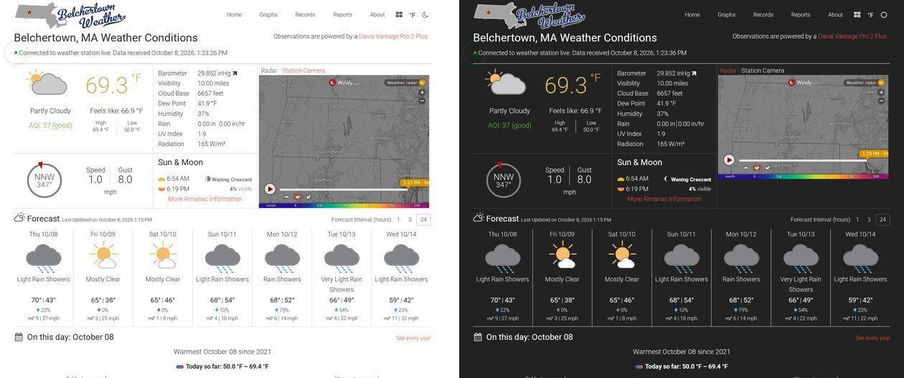
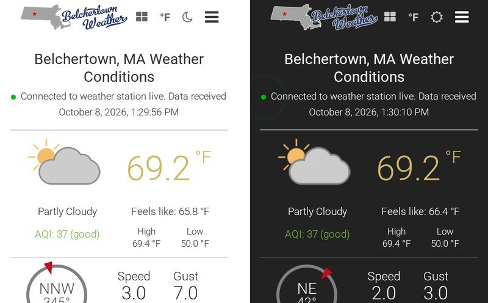

---
hide:
  - navigation
---

# Belchertown

A skin (website theme) for the [weewx weather software](https://weewx.com), modeled after [BelchertownWeather.com](https://belchertownweather.com). Install it, point it at your station, and you get a modern weather website with live updates, forecasts, records and interactive charts. Free and open source.

[Install it](install.md){ .md-button .md-button--primary } [New to this? Start here](before-you-start.md){ .md-button } [The chart builder](charts/chart-builder.md){ .md-button } [See the chart gallery](charts/gallery.md){ .md-button } [Download the latest release](https://github.com/poblabs/weewx-belchertown/releases/latest){ .md-button }

!!! info "Belchertown 3 needs weewx 5.0 or newer"
    On weewx 3 or 4, use [Belchertown 1.3.1](https://github.com/poblabs/weewx-belchertown/releases/tag/weewx-belchertown-1.3.1). Coming from 1.3.1? See [Upgrading from 1.x](upgrading.md).

## What you get

-   **A chart builder**

    ---

    Make a chart by pointing and clicking: pick what to plot and watch it draw from your own data, then copy the text it gives you. No chart settings to write by hand. [See how](charts/chart-builder.md), or [try it on BelchertownWeather.com](https://belchertownweather.com/chart-builder/).

-   **Charts you design**

    ---

    Lines, columns, wind roses, Hays charts, temperature radials and gauges, from any reading in your database over any time range. Start in the chart builder, or copy one from the [gallery](charts/gallery.md).

-   **Highcharts or ECharts**

    ---

    Draw the charts with Highcharts, or with Apache ECharts, which is free for any website, including businesses, clubs and non-profits. One setting switches the whole site. [Compare them](charts/index.md#highcharts-or-echarts).

-   **Live updates**

    ---

    With MQTT, the current conditions change every few seconds without reloading the page. [Set it up](live-updates.md).

-   **Forecasts and alerts, no setup**

    ---

    Forecast, air quality and (in the US) weather alerts from Open-Meteo and the National Weather Service, free and with no account. Xweather is optional. [Forecasts](forecasts.md).

-   **Records and "On this day"**

    ---

    Records for this year and all time, the all-time records broken this year, and how today's date has gone in every year since your station started.

-   **Light, dark, °F or °C**

    ---

    A light and dark theme that can follow sunrise and sunset, and a units button that switches the whole site between °F and °C. [Make it yours](customize.md).

-   **Phones and wall displays**

    ---

    Works on phones and tablets and can be added to the home screen like an app. A [kiosk view](kiosk.md) fits a TV or a spare monitor.

-   **Yours to change**

    ---

    Your own text, logo, home page blocks, About page, CSS and [charts on your own pages](charts/custom-pages.md), all kept across upgrades.

[{ width="480" }](assets/phone_light_dark.jpg)

## Belchertown 3: the original, rebuilt

This is the original Belchertown skin, back in active development and refactored from the ground up for weewx 5: a chart builder that writes your chart settings for you, faster pages, a new home page and Records page, forecasts and alerts with no setup, a °F/°C button, and since 3.1 a second, free chart library. The [changelog](https://github.com/poblabs/weewx-belchertown/blob/master/changelog) lists everything that changed.

**Why 3.0 and not 2.0?** While this skin was quiet, uajqq kept it going as [New Belchertown](https://github.com/uajqq/weewx-belchertown-new), a separate fork with its own 2.x versions. The two are different skins, so this one jumps from 1.3.1 straight to 3.0 to keep the version numbers apart. Both are free; use whichever suits you.

## Help

* Questions: ask in [GitHub Discussions](https://github.com/poblabs/weewx-belchertown/discussions).
* Found a bug? [Open an issue](https://github.com/poblabs/weewx-belchertown/issues/new/choose).
* Already installed? [How do I...?](how-do-i.md) answers the everyday questions, and [Upgrade](upgrade.md) covers new versions.
* Something not working? Start with [Troubleshooting](troubleshooting.md).
